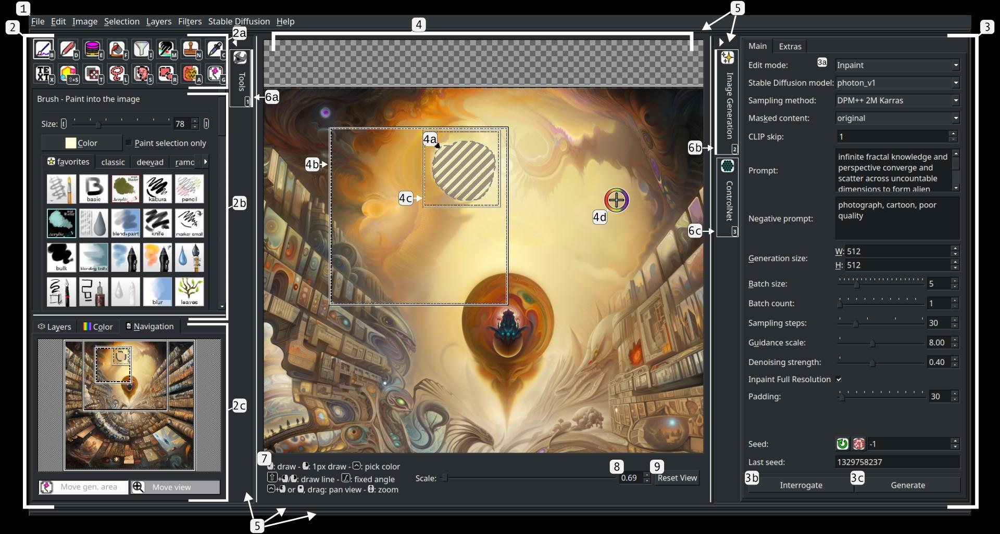
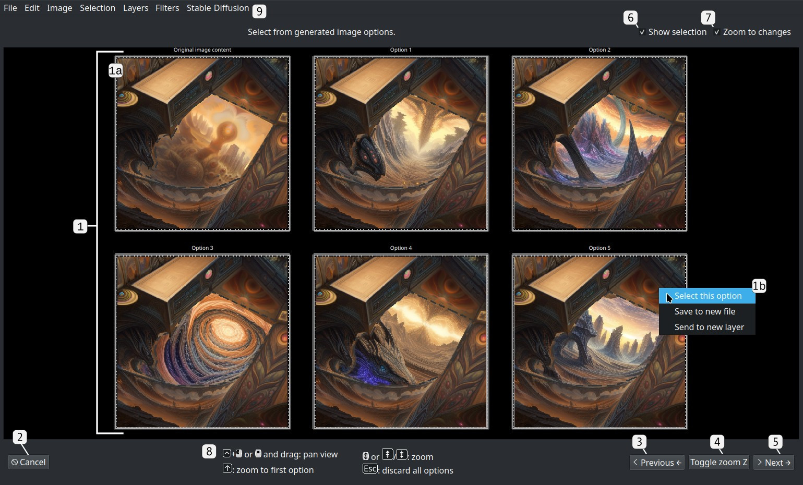

# IntraPaint Controls

## Main View

1. **Main menu**: See the [menu option guide](./menu_options.md) for descriptions of all menu options.
2. **Tool panel**: The main control panel for manual image editing.
    - 2a. **Tool buttons**: The full set of available tools. Click one to activate it, or press the key shown in the bottom right corner of the tool button icon.
    - 2b. **Active tool control panel**: This panel changes depending on what tool is selected. Refer to the [IntraPaint tool guide](./tool_guide.md) for an in-depth overview of all tools and tool panels.
    - 2c. **Extra control tabs**: Provides smaller versions of the [layer window](./menu_options.md#show-layer-window-f7), [color picker control panel](./tool_guide.md#user-interface-color-picker-panel), and [navigation window](./menu_options.md#show-navigation-window-ctrlaltw). See [layer menu options](./menu_options.md#layers-menu) for more information on IntraPaint's layer system.
3. **Image Generation panel**: The main control panel for AI image editing. This panel is only available after you've installed and configured Stable Diffusion, [click here](./stable_diffusion_setup.md) for details.
    - 3a. **Stable Diffusion AI settings**:  See the [Stable Diffusion control guide](./stable-diffusion.md) for detailed descriptions of these controls.
    - 3b. **"Interrogate" button**:  Use AI image analysis to automatically generate a description of the edited image. This button is not available when using ComfyUI for Stable Diffusion image generation.
    - 3c. **"Generate" button**:  Click to trigger AI image generation, creating or altering image content to insert into the [image generation area](./inpainting_guide.md#generation-area). Clicking this will switch IntraPaint to the [generated image selection view](#generated-image-selection-view).
4. **Image viewport**: View and interact with the edited image.
    - 4a. **Selected content**: The dashed lines and red tint show areas specifically marked for editing. See the [selection tool guide](./tool_guide.md#selection-tools) for more information on the way IntraPaint uses selection.
    - 4b. **Image generation area**:  This rectangle marks the area used for AI image generation, placed using the [Generation area tool](./tool_guide.md#-image-generation-area-tool-g).
    - 4c. **Inpaint padding bounds**: The reduced image generation area used when the image generation editing mode is set to "inpaint" and "Inpaint Full Resolution" is checked. See the [inpainting guide](./inpainting_guide.md#inpaint-full-resolution-checkbox) for more details.
    - 4d. **Brush cursor**: When over the image viewport, the mouse cursor will change based on the current active tool.
5. **Panel docks**: The main control panels are docked around the image. Drag a panel by its title bar to any edge of the window, onto another panel to stack them in one group, or out of the window to float it. Panels at the top and bottom span the full window width. The button at the right of a panel's title bar floats it, and the close button hides it. Right-click a panel's title bar or its icon on the window edge to stack it with another group of panels ("Tab with"), move it into a new full-length strip along a window edge ("Move to edge"), float or dock it, hide it, or move every panel to one edge. Use the [View menu's Panels list](./menu_options.md#panels) to show a hidden panel again, or to reset every panel to its starting place. IntraPaint remembers the panel layout when it closes.
6. **Panel groups**:  Panels stacked in the same place show one at a time. Opening one with its rail button or its key shows it in place of the panel showing there, and pressing the key of the panel that is showing hides it.
    - 6a. **Tools** (key 1): The tool panel. It is always available.
    - 6b. **Image Generation** (key 2): The image generation panel. It is only available when AI image generation is configured.
    - 6c. **ControlNet** (key 3): The [ControlNet panel](./stable-diffusion.md#controlnet-panel). It is only available when the image generator supports ControlNet.
7. **Panel rails**: A narrow rail of icon buttons runs along each window edge that has a panel, with one button per panel and its key under the icon. Hover over a button to see the panel's name. Click a button to show a panel in place of the one showing in its group, or to hide it if it is already showing. A panel's button follows it when you move it to another edge. Buttons are grouped like the panels, and each group's buttons start beside the panels they belong to, with a line marking where one group ends and the next begins. The rail also holds the most recently used tools after the Tools panel's group, as many as fit, and a **Generate** button that shows while the Image Generation panel is hidden. The "Maximum recent tool icons" setting limits how many tools it shows.
8. **Tool control hints**:  Lists controls for the current active tool. Right-clicking this spot opens a menu where you can show or hide these tips.
9. **Image zoom controls**: Directly sets how zoomed-in the image viewport is.  At 1.0, the image is shown at actual size.
10. **Image zoom toggle button**:  Click to reset the image to its default position and scale, centering and showing the entire image. If the image generator is configured and the view is already at the default, button text will change to "Zoom In", and clicking it will center the image generation area.

---
## Generated Image Selection View

When AI image generation is triggered, the usual process is to create several variations at once, then choose the best one. This view is where you make that selection.  The generated image selection view can only be accessed when AI image generation is configured.  It is automatically shown when you press the "generate" button, or select "generate" from the Image menu.  IntraPaint will return to the main view once you select an option, or choose to reject all of them.

1. **Generated image options**: The available options created by a single image generation operation, arranged in a grid. When you left-click an option, it gets inserted directly into the active image layer at the image generation area, and the selection view closes.
    - 1a. **Original image content**:  The original unedited image content is always shown in the first spot for comparison.  Left-clicking this option will close the selection view without making any changes. 
    - 1b. **Image option context menu**:  Right-clicking any image option brings up a menu with additional options.
       * **"Select this option"**: This choice behaves the same as left-clicking the image option.
       * **"Save to new file"**:  Open a file dialog to save the selected option as a new file. This does not close the selection view.
       * **"Send to new layer"**: Creates a new image layer from the selected option, without closing the selection view. This is useful if you want to save pieces from multiple options.
2. **Cancel button**:  Close the selection view, and return to normal editing.  If AI image generation is still in-progress, this will cancel it.
3. **"Zoom Previous" button**:  From the zoomed-out view, this zooms in on the last image option. If already zoomed in, this switches the view to the previous option in the list.
4. **"Toggle" Zoom button**: Toggle between the zoomed-out view displaying all options, and the zoomed-in view for inspecting a single option in detail.
5. **"Zoom Next" button**: From the zoomed-out view, this zooms in on the first image option. If already zoomed in, this switches the view to the next option in the list.
6. **"Show selection" checkbox**:  When in "inpaint" mode, this checkbox controls whether the selected area is outlined in each image option. 
7. **"Zoom to changes" checkbox**:  When in "inpaint" mode, entering the zoomed-in view while this option is checked will zoom in even further to focus on the updated area within the previewed option.
8. **Control hints**:  Shows additional controls.  Most of the controls for panning and zooming within the image viewport also work within the selection view.
9. **Main menu**:  Most menu options are disabled when in the selection view, but options for saving the image and creating new layers will still be available.