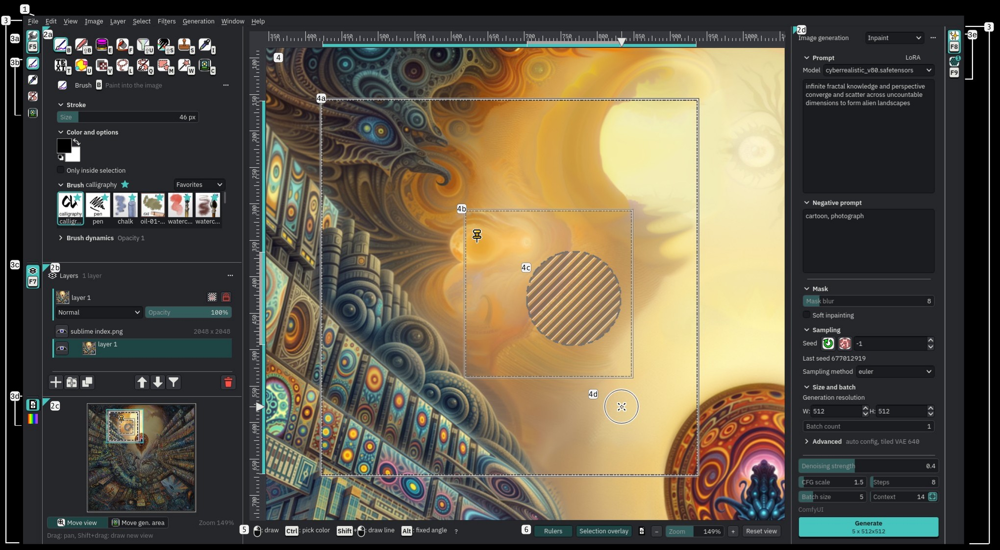
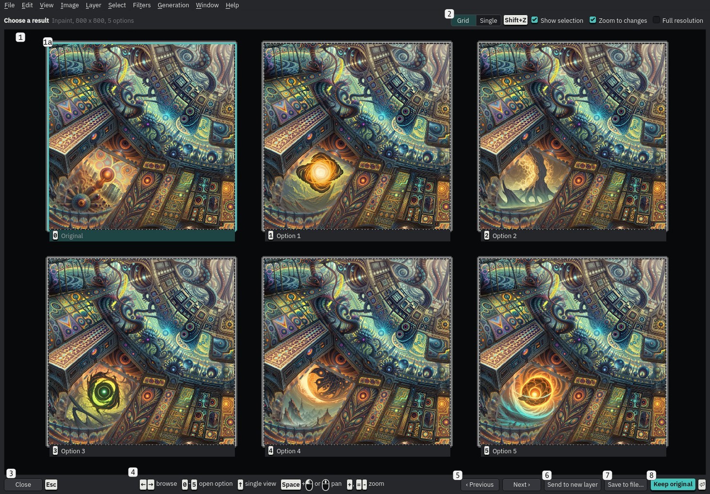

# IntraPaint Controls

## Main View

1. **Main menu**: See the [menu option guide](./menu_options.md) for descriptions of all menu options.
2. **Panels**: The main control panels are docked around the image. Panels can sit along any window edge, and panels at the top and bottom span the full window width. Panels in the same place can be stacked in a tabbed group, which shows one panel at a time, or split into separate groups side by side, like the three groups on the left side of this screenshot. A panel can also float in its own window, outside the main window if you like.
   - Docked panels have no title bar. To drag one, drag its icon in the panel rail (3). A floating panel has a title bar with buttons to dock or close it, and dragging that bar moves it: to any edge of the window, onto another panel, or over a rail, where it works like dragging a rail icon.
   - Right-click a panel's rail icon, or a floating panel's title bar, to stack it with another group of panels ("Tab with"), place it in a group of its own on one side of a group ("Split beside"), move it into a new full-length strip along a window edge ("Move to edge"), float or dock it, hide it, or move every panel to one edge.
   - Opening a panel in a group, with its rail icon or its key, shows it in place of the panel showing there, and pressing the key of the panel that is showing hides it. Moving the showing panel out of its group leaves the group's space open, showing the group's next panel. Moving a hidden panel out leaves the showing panel as it was.
   - A closed panel's icon returns to the rail of the edge it was last docked on, and clicking it there opens it floating again. Use the [Window menu's panel list](./menu_options.md#panels) to show a hidden panel again, [save and apply panel layouts](./menu_options.md#layouts), or [reset every panel to its starting place](./menu_options.md#reset-panel-layout-ctrlaltshiftp). IntraPaint remembers the panel layout when it closes.
   - 2a. **Tools** (F5): The main control panel for manual image editing. It is always available. The tool buttons at the top hold the full set of available tools: click one to activate it, or press the key shown in the bottom right corner of its icon. Below them, the active tool's controls change depending on what tool is selected. Refer to the [IntraPaint tool guide](./tool_guide.md) for an in-depth overview of all tools and their controls.
   - 2b. **Layers** (F7): Manages image layers. See the [Layers panel guide](./menu_options.md#layers-panel-f7) and the [layer menu options](./menu_options.md#layer-menu) for more information on IntraPaint's layer system.
   - 2c. **Navigation** (Ctrl+Alt+W): Shows the entire image, and moves the main view or the generation area. See the [Navigation panel guide](./menu_options.md#navigation-panel-ctrlaltw).
   - 2d. **Image Generation** (F8): The main control panel for AI image editing. It is only available after you've installed and configured Stable Diffusion, see the [Stable Diffusion setup guide](./stable_diffusion_setup.md) for details. See the [Stable Diffusion control guide](./stable-diffusion.md) for detailed descriptions of its controls. The **Generate** button at the bottom triggers AI image generation, creating or altering image content to insert into the [generation area](./inpainting_guide.md#generation-area), and switches IntraPaint to the [generated image selection view](#generated-image-selection-view).

    Two more panels are hidden in this screenshot, stacked behind Navigation and Image Generation: the [Color panel](./tool_guide.md#user-interface-color-picker-panel), and the [ControlNet panel](./stable-diffusion.md#controlnet-panel) (F9), which is only available when the image generator supports ControlNet.
3. **Panel rails**: A narrow rail of icon buttons runs along each window edge that has a panel, with one button per panel and its key under the icon. Hover over a button to see the panel's name. Click a button to show a panel in place of the one showing in its group, or to hide it if it is already showing. Buttons are grouped like the panels, and each group's buttons start beside the panels they belong to, with a line marking where one group ends and the next begins. A panel's button follows it when you move it to another edge. A **Generate** button appears on the rail while the Image Generation panel is hidden.
   - Drag an icon within its rail to rearrange panels. Drop it on another group's icons to stack the panel in that group, between groups to give it a group of its own beside the nearer one, or elsewhere among its own group's icons to reorder that group, which then shows its first panel. A highlight shows where it will go.
   - Drag an icon out of its rail to move the panel like a title bar, holding it by its upper-left corner: to any edge of the window, onto another panel, or out of the window to float it. Dragging it back over a rail works like dragging an icon within that rail.
   - A floating panel shows its icon in its own title bar instead of a rail.
   - 3a. **Tools panel icon**.
   - 3b. **Recent tools**: The most recently used tools, always shown after the Tools panel's group, as many as fit. Click one to switch to that tool. The "Maximum recent tool icons" setting limits how many it shows.
   - 3c. **Layers panel icon**.
   - 3d. **Navigation and Color panel icons**: These two panels are stacked in one group, with Navigation showing.
   - 3e. **Image Generation and ControlNet panel icons**: Another stacked group, with Image Generation showing. The number on the ControlNet icon shows how many ControlNet modules are active.
4. **Image viewport**: View and interact with the edited image. Rulers along the top and left edges label image coordinates. They mark the cursor's position with an arrow, and highlight the span of the generation area and of the selected content. Right-click the **Rulers** button (6) to turn those highlights on or off.
   - 4a. **Generation area**: This rectangle marks the area used for AI image generation, placed using the [Generation area tool](./tool_guide.md#-generation-area-tool-c).
   - 4b. **Inpaint context bounds**: The reduced generation area used when the image generation editing mode is set to "inpaint" and "Limit context to the selection" is checked. See the [inpainting guide](./inpainting_guide.md#limit-context-to-the-selection-checkbox) for more details. The pin icon is a context pin: the bounds stretch to include every pin, but nothing under a pin is inpainted. Right-click with a selection tool to add or remove one, see the [selection brush tool](./tool_guide.md#-selection-brush-tool-q) for details.
   - 4c. **Selected content**: The dashed outline and grey diagonal stripes show areas specifically marked for editing. See the [selection tool guide](./tool_guide.md#selection-tools) for more information on the way IntraPaint uses selection.
   - 4d. **Brush cursor**: When over the image viewport, the mouse cursor will change based on the current active tool. Brush tools show a crosshair where they paint, and a circle around it the size of the brush. The circle hides when the brush is smaller on screen than the crosshair.
5. **Tool control hints**: Lists controls for the current active tool. When they don't all fit, the **?** button at the end shows the full list. Right-clicking this spot opens a menu where you can show or hide these tips.
6. **View options**: When the window is too narrow for all of these, the ones that don't fit move into a **More** menu.
   - **Rulers**: Shows or hides the rulers around the image viewport.
   - **Selection overlay**: Shows or hides the selection's stripes. While hidden, only the selection outline is drawn.
   - **Navigation button**: Opens the [Navigation panel](./menu_options.md#navigation-panel-ctrlaltw).
   - **Zoom**: Shows and sets how zoomed-in the image viewport is. At 100%, the image is shown at actual size. Drag the field or use the **-** and **+** buttons to zoom out or in.
   - **Reset view**: Restores the default position and scale, centering and showing the entire image. It is only enabled while the view isn't already at the default.

---

## Generated Image Selection View

When AI image generation is triggered, the usual process is to create several variations at once, then choose the best one. This view is where you make that selection. The generated image selection view can only be accessed when AI image generation is configured. It is automatically shown when you press the "Generate" button, or select [Generate](./menu_options.md#generate-f4) from the Generation menu. IntraPaint will return to the main view once you choose an option or close the view. Most menu options are disabled while the selection view is open, but options for saving the image and creating new layers are still available.

1. **Generated image options**: The available options created by a single image generation operation, numbered from 1. Left-click an option to insert it directly into the active image layer at the generation area and close the selection view. Right-click an option for a menu that can select it, save it to a new file, or send it to a new layer, like the buttons below.
   - 1a. **Original image content**: The original unedited image content is always shown first, as option 0, for comparison. Choosing it closes the selection view without making any changes. One option is focused at a time, marked by its outline and highlighted label, and the buttons along the bottom act on the focused option. Browse with the arrow keys, the **Previous** and **Next** buttons or horizontal scrolling, or type an option's number to jump to it; each of these opens the focused option in the single view. **Enter** applies the focused option, and **Esc** returns from the single view to the grid, or closes the selection view from the grid.
2. **View controls**:
   - **Grid / Single** (Shift+Z): Switches between the grid of every option and a close-up of the focused option. The single view is ideal for blink comparison: hold **Alt** to show the original image content in place of the focused option, and release it to switch back, or step back and forth between options to compare them with each other. Panning and zooming work like in the main image viewport, and the view keeps your pan and zoom as you move between options.
   - **Show selection**: Outlines the selected area in each option. It is only available for inpainted options.
   - **Zoom to changes**: Zooms the single view in to the inpainted area, instead of the whole generation area. It is only available when inpainting a selection smaller than the generation area, and checking it switches to the single view.
   - **Full resolution**: Image options are generated at the generation resolution set in the Image Generation panel, then scaled to fit the generation area when inserted into the image. By default, options are shown at the size they will be inserted at. Check this to show them at the size they were generated at instead. **Save to file...** (7) always saves an option at its full resolution, so use it to keep generated detail that scaling into the generation area would lose.
3. **Close button**: Closes the selection view and returns to normal editing, without changing the image. If generation is still running, this stops it. The options stay available, and [Reopen last generated options](./menu_options.md#reopen-last-generated-options) in the Generation menu shows them again. While generating, this button reads **Cancel** until the first option arrives, and a **Stop** button appears once options arrive, stopping generation while keeping the finished options open.
4. **Control hints**: Lists keyboard and mouse controls for the current view.
5. **Previous / Next buttons**: Focus the previous or next option, opening it in the single view.
6. **Send to new layer button**: Creates a new image layer from the focused option, without closing the selection view. This is useful if you want to save pieces from multiple options.
7. **Save to file button**: Opens a file dialog to save the focused option as a new file at its full resolution, without closing the selection view.
8. **Apply button**: Applies the focused option and returns to the editor. Its text names the focused option, such as **Use option 2**. It reads **Keep original** here because the original image content is focused, and choosing it leaves the image unchanged.

When the window is too narrow, **Send to new layer** and **Save to file...** move into a **More** menu.
