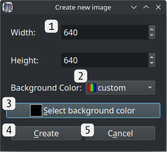
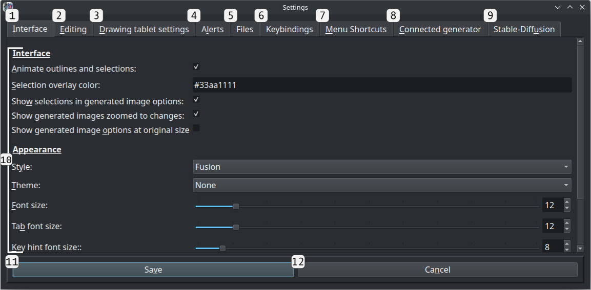
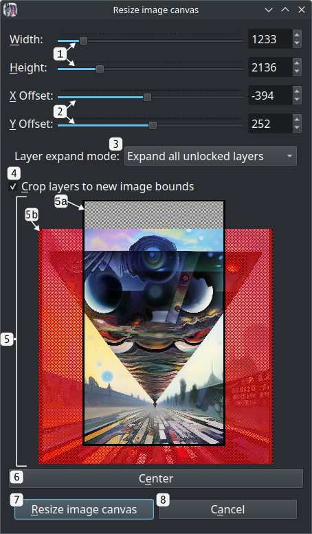
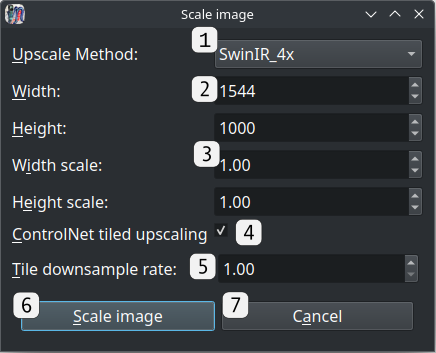
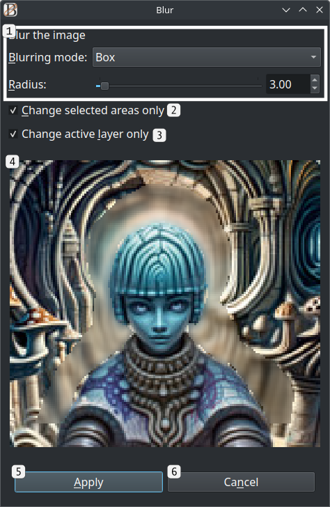
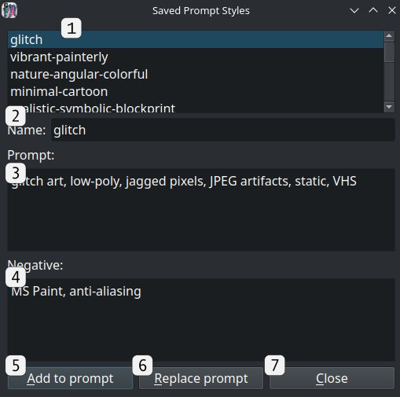
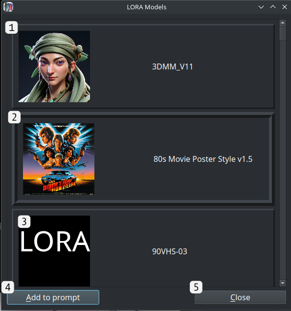
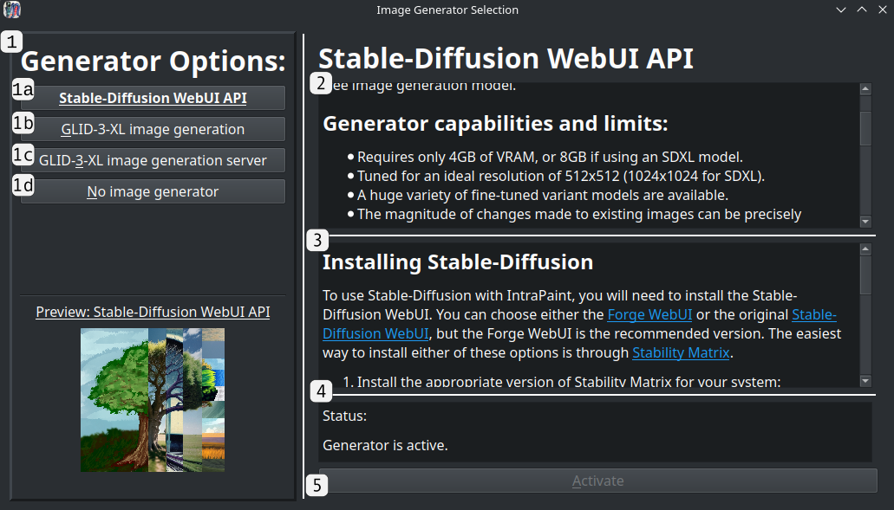
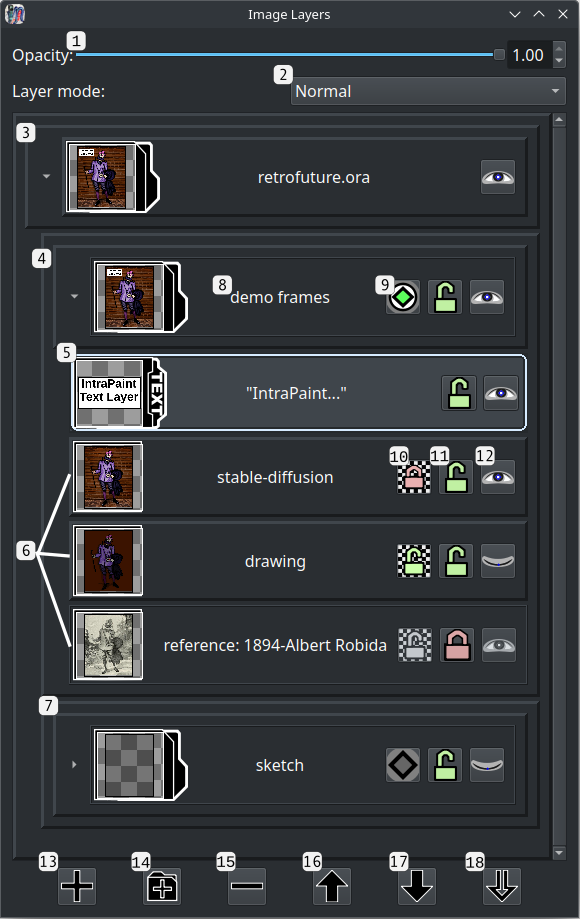
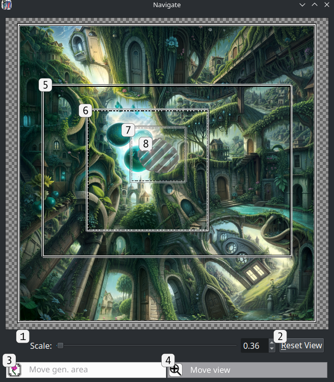

# Main menu options

This guide explains all of IntraPaint's menu options. All menu option shortcuts are configurable.

---

## Table of Contents

1. [File menu](#file-menu)
   - [New (Ctrl+N)](#new-ctrln)
     - [New image window](#new-image-window)
   - [Open (Ctrl+O)](#open-ctrlo)
   - [Open recent](#open-recent)
   - [Open as layers (Ctrl+Alt+O)](#open-as-layers-ctrlalto)
   - [Save (Ctrl+S)](#save-ctrls)
   - [Save as (Ctrl+Shift+S)](#save-as-ctrlshifts)
     - [Unsaved changes](#unsaved-changes)
   - [Revert (F12)](#revert-f12)
   - [Quit (Ctrl+Q)](#quit-ctrlq)
2. [Edit menu](#edit-menu)
   - [Undo (Ctrl+Z)](#undo-ctrlz)
   - [Redo (Ctrl+Shift+Z)](#redo-ctrlshiftz)
   - [Cut (Ctrl+X)](#cut-ctrlx)
   - [Copy (Ctrl+C)](#copy-ctrlc)
   - [Paste (Ctrl+V)](#paste-ctrlv)
   - [Clear (Delete)](#clear-delete)
   - [Keyboard shortcuts (Ctrl+Alt+Shift+K)](#keyboard-shortcuts-ctrlaltshiftk)
   - [Preferences (Ctrl+K)](#preferences-ctrlk)
     - [Preferences window](#preferences-window)
   - [Swap and reset colors](#swap-and-reset-colors)
3. [View menu](#view-menu)
   - [Zoom and view](#zoom-and-view)
4. [Image menu](#image-menu)
   - [Canvas size (Ctrl+Alt+C)](#canvas-size-ctrlaltc)
     - [Resize image canvas window](#resize-image-canvas-window)
   - [Scale image (Ctrl+Alt+I)](#scale-image-ctrlalti)
     - [Scale image window](#scale-image-window)
   - [Transform](#transform)
     - [Flip image horizontally](#flip-image-horizontally)
     - [Flip image vertically](#flip-image-vertically)
     - [Rotate image 90° CW](#rotate-image-90-cw)
     - [Rotate image 90° CCW](#rotate-image-90-ccw)
     - [Rotate image 180°](#rotate-image-180)
   - [Crop to selection (Ctrl+Alt+Shift+C)](#crop-to-selection-ctrlaltshiftc)
   - [Crop to generation area (Ctrl+Alt+G)](#crop-to-generation-area-ctrlaltg)
   - [Fit canvas to layers (Ctrl+Alt+R)](#fit-canvas-to-layers-ctrlaltr)
   - [Image metadata (Ctrl+Alt+Shift+I)](#image-metadata-ctrlaltshifti)
5. [Layer menu](#layer-menu)
   - [New layer (Ctrl+Shift+N)](#new-layer-ctrlshiftn)
   - [New layer group (Ctrl+Shift+G)](#new-layer-group-ctrlshiftg)
   - [Duplicate layer (Ctrl+J)](#duplicate-layer-ctrlj)
   - [Delete layer (Shift+Delete)](#delete-layer-shiftdelete)
   - [Rename layer (F2)](#rename-layer-f2)
   - [Stack](#stack)
     - [Select previous layer (Alt+])](#select-previous-layer-alt)
     - [Select next layer (Alt+[)](#select-next-layer-alt)
     - [Move layer up (Ctrl+])](#move-layer-up-ctrl)
     - [Move layer down (Ctrl+[)](#move-layer-down-ctrl)
     - [Move layer to top (Ctrl+Shift+])](#move-layer-to-top-ctrlshift)
   - [Transform](#transform-1)
     - [Mirror layer horizontally (Ctrl+Shift+H)](#mirror-layer-horizontally-ctrlshifth)
     - [Mirror layer vertically (Ctrl+Shift+V)](#mirror-layer-vertically-ctrlshiftv)
     - [Rotate layer 90° CW (Ctrl+Shift+R)](#rotate-layer-90-cw-ctrlshiftr)
     - [Rotate layer 90° CCW (Ctrl+Shift+L)](#rotate-layer-90-ccw-ctrlshiftl)
   - [Merge layer down (Ctrl+E)](#merge-layer-down-ctrle)
   - [Merge group (Ctrl+Shift+Alt+G)](#merge-group-ctrlshiftaltg)
   - [Merge visible (Ctrl+Shift+E)](#merge-visible-ctrlshifte)
   - [Flatten layer (Ctrl+Shift+F)](#flatten-layer-ctrlshiftf)
   - [Layer to image size](#layer-to-image-size)
   - [Crop layer to selection (Ctrl+Alt+Shift+X)](#crop-layer-to-selection-ctrlaltshiftx)
   - [Crop layer to content (Ctrl+Shift+P)](#crop-layer-to-content-ctrlshiftp)
6. [Select menu](#select-menu)
   - [Select all (Ctrl+A)](#select-all-ctrla)
   - [Deselect all (Ctrl+D)](#deselect-all-ctrld)
   - [Invert selection (Ctrl+Shift+I)](#invert-selection-ctrlshifti)
   - [Select layer content (Ctrl+Shift+A)](#select-layer-content-ctrlshifta)
   - [Grow selection (Ctrl+Alt+=)](#grow-selection-ctrlalt)
   - [Shrink selection (Ctrl+Alt+-)](#shrink-selection-ctrlalt-)
   - [Clear context pins (Ctrl+Alt+P)](#clear-context-pins-ctrlaltp)
7. [Filters menu](#filters-menu)
   - [Repeat last filter (Ctrl+F)](#repeat-last-filter-ctrlf)
   - [RGBA color balance (Ctrl+B)](#rgba-color-balance-ctrlb)
   - [Brightness/contrast (Ctrl+2)](#brightnesscontrast-ctrl2)
   - [Saturation (Ctrl+U)](#saturation-ctrlu)
   - [Posterize (Ctrl+5)](#posterize-ctrl5)
   - [Invert (Ctrl+I)](#invert-ctrli)
   - [Blur (Ctrl+3)](#blur-ctrl3)
   - [Sharpen (Ctrl+4)](#sharpen-ctrl4)
8. [Generation menu](#generation-menu)
   - [Generate (F4)](#generate-f4)
   - [Reopen last generated options](#reopen-last-generated-options)
   - [View saved prompt styles (Ctrl+Alt+1)](#view-saved-prompt-styles-ctrlalt1)
   - [View LoRA models (Ctrl+Alt+2)](#view-lora-models-ctrlalt2)
   - [LCM mode (F10)](#lcm-mode-f10)
   - [Clear GPU memory](#clear-gpu-memory)
   - [Select image generator (F11)](#select-image-generator-f11)
     - [Image Generator Selection window](#image-generator-selection-window)
9. [Window menu](#window-menu)
   - [Panels](#panels)
   - [Layers panel (F7)](#layers-panel-f7)
     - [Layers panel controls](#layers-panel-controls)
   - [Navigation panel (Ctrl+Alt+W)](#navigation-panel-ctrlaltw)
     - [Basic controls](#basic-controls)
     - [Navigation panel controls](#navigation-panel-controls)
   - [Layouts](#layouts)
   - [Reset panel layout (Ctrl+Alt+Shift+P)](#reset-panel-layout-ctrlaltshiftp)
   - [Move all panels to edge](#move-all-panels-to-edge)
10. [Help menu](#help-menu)
    - [IntraPaint help (F1)](#intrapaint-help-f1)
    - [Report a bug](#report-a-bug)
    - [Release notes](#release-notes)
    - [About IntraPaint](#about-intrapaint)
    - [About Qt](#about-qt)

---

## File menu

### New (Ctrl+N)

Opens a window where you can create a new image with a single layer, replacing the open image.

#### New image window

1. **Width and height controls**: Sets the new image's initial resolution. The default value is configurable, found in [settings](#preferences-ctrlk) under the **"Editing"** category as **"Default image size"**.
2. **Background color dropdown**:  The initial color of the new image's starting layer. Options are **white**, **black**, **transparent**, and **custom**.
3. **Custom background color button**:  Only visible when the background color dropdown is set to **custom**, clicking this button will open a color picker where you can select any color.
4. **Create button**:  When clicked, all previous image data is removed, and a new image is opened with the chosen settings. If the open image has [unsaved changes](#unsaved-changes), IntraPaint first asks whether to save them.
5. **Cancel button**  Close the new image window without changing anything.

### Open (Ctrl+O)

Open a file picker dialog to select an existing image for editing.  Loading a new image replaces the current image and clears the undo history, without asking about unsaved changes.

### Open recent

Lists the files you opened most recently, newest first. Choosing one opens it like **Open**. Files that no longer exist are greyed out. **Clear recent files** empties the list.

### Open as layers (Ctrl+Alt+O)

Open a file picker dialog to load one or more images for editing as new layers.  Unlike "Open", this option does not clear image layers that were already open.

### Save (Ctrl+S)

If the image was loaded from a file or already saved, choosing this option will immediately update the same file. If the image hasn't been saved before, it will open a file picker dialog, as if **Save as** was selected.

### Save as (Ctrl+Shift+S)

Open a file picker dialog to select where to save the current image and which format to use. IntraPaint supports most common image formats.  The recommended format for saving files you intend to keep editing is **.ora/OpenRaster**. This is the only format that will save individual layers separately.

#### Unsaved changes

The window title shows the open file's name, marked with `*` while the image has changes that aren't saved. Undoing back to the last save clears the mark. **New**, **Revert** and **Quit** ask before discarding unsaved changes: **Save** saves first, and stops if the save fails or is cancelled.

Saving an image with more than one layer to a format other than .ora flattens it, unless it is saved as an animation. The file then doesn't hold the layers, so the image keeps counting as unsaved until it is saved as .ora.

### Revert (F12)

Reload the current image from its file, discarding all changes made since the last save. If there are [unsaved changes](#unsaved-changes), IntraPaint first asks whether to save them.

### Quit (Ctrl+Q)

Exit IntraPaint. If the image has [unsaved changes](#unsaved-changes), IntraPaint first asks whether to save them.

---

## Edit menu

The main options in the edit menu (undo, redo, cut, copy, paste, clear), all behave differently if text is selected for editing.  If currently editing text, IntraPaint will try and apply the action to the text first.  If it can't, it will instead apply the action to the image as usual.

### Undo (Ctrl+Z)

Reverses the last change made to the image (or active text).  IntraPaint allows most actions to be reversed with undo, with a few notable exceptions:

- Undo will not change saved image files.
- Undo will not affect most changes that affect the UI only, like switching tools or moving tabs.
- Undo will not affect changes to settings.

Each action is its own undo step, except that a continuous gesture, like dragging a layer, the opacity slider or the generation area, or typing in the text tool, undoes as one step, and a menu option that changes several layers undoes as one step.  The maximum number of previous actions to save for undo is also configurable, under **Editing/Maximum undo count**.

### Redo (Ctrl+Shift+Z)

Restore an action that was previously reversed using undo.

### Cut (Ctrl+X)

When an unlocked, visible [layer](#layers-panel-f7) is active, and part of that layer is [selected](./tool_guide.md#selection-tools), choosing cut will replace the selected areas with transparency, and cache the removed image data for [pasting](#paste-ctrlv) until something else gets cut or copied.

When text is selected and focused, this will instead clear the selected text and place it in the system clipboard.

### Copy (Ctrl+C)

When a visible [layer](#layers-panel-f7) is active, and part of that layer is [selected](./tool_guide.md#selection-tools), choosing copy will cache the selected areas so that they can be duplicated using [paste](#paste-ctrlv).  Copy and cut only act on the active layer, and will not affect other layers.  If you want to copy across all visible layers, select the main layer group (the top item) in the layer panel.

When text is selected and focused, this will instead copy that text into the system clipboard.

### Paste (Ctrl+V)

Creates a new image layer from selected image content.  The new layer will be placed above the current active layer, or at the top of the group if the active layer is an unlocked group.  It can then be moved using the [layer transformation tool](./tool_guide.md#-transform-layer-tool-v), or merged into another layer with the [merge down option](#merge-layer-down-ctrle).

If a text field is focused and the system clipboard is not empty, this will instead paste that text into the text field.

### Clear (Delete)

Behaves identically to [cut](#cut-ctrlx), except that cut image data can't be pasted, and cut text isn't saved in the system clipboard.

### Keyboard shortcuts (Ctrl+Alt+Shift+K)

Opens the [Preferences window](#preferences-window) at the **"Keybindings"** tab. The **"Menu Shortcuts"** tab beside it holds the keys for menu entries.

### Preferences (Ctrl+K)

Opens a window where you can edit IntraPaint's saved settings. Hold your mouse over any item in settings to see a tooltip describing what it does. The location where settings files are saved is automatically selected and varies depending on your OS, but you can view that location under the "Files" tab.

#### Preferences window

1. **"Interface" tab**:  Contains various settings related to IntraPaint's appearance and the ways it displays data.
2. **"Editing" tab**:  Contains settings related to undo/redo behavior and image sizes, and **"Generation area follows selection"**, which controls [how the generation area follows selection edits](./tool_guide.md#following-the-selection).
3. **"Drawing tablet settings" tab**:  Provides controls you can use to adjust the sensitivity of a pressure-sensitive drawing tablet.
4. **"Alerts" tab**:  Enable or disable various warnings that IntraPaint will occasionally show you.  If a popup window has a "don't show this again" or "remember my choice" option, picking that option will change one of the entries in this category.
5. **"Files" tab**:  Sets the directories IntraPaint will search for extra fonts, MyPaint brush files, or (if necessary) MyPaint library files.  This section also shows you where settings are saved as files, although those values can't be changed.
6. **"Keybindings" tab**:  Sets editing control keys, navigation keys, and tool shortcuts. You'll need to type in the key's name to set it, e.g. typing "PgDown" instead of pressing the page down key.  You can bind multiple keys to the same action by separating the key names with commas, e.g. "PgDown,D" to bind both page down and D.
7. **"Menu Shortcuts" tab**:  Sets keyboard shortcuts for all menu options.
8. **"Stable Diffusion" tab**:  Visible only when a Stable Diffusion WebUI generator is active, this tab provides access to infrequently-needed image generation settings. When using the Stable Diffusion WebUI generator, it also provides access to the connected image generation program's settings. See [Stable Diffusion settings](./stable-diffusion.md#stable-diffusion-settings) for details.
9. **Current category settings**:  Settings for the current selected tab, replaced when a new tab is selected. Hold the mouse over the control for any of these (*not* the label) to see a tooltip describing it.
10. **Save button**:  Close the settings window, saving changes made across all tabs.  Most changes will be applied immediately, but you may need to restart IntraPaint before some of them take effect.
11. **Cancel button**:  Close the settings window, discarding all changes.

### Swap and reset colors

These have no menu entries, only keys: **Shift+X** swaps the foreground and background colors, and **Shift+D** resets them to black and white. The color picker panel has buttons for both.

---

## View menu

Actions that change how the image is shown, without changing the image.

### Zoom and view

- **Zoom in** and **Zoom out**: Change the zoom one step, with Ctrl+= and Ctrl+-. The +, = and - keys (configurable under Navigation) also zoom.
- **Actual size (100%)** (Ctrl+1 or Ctrl+Alt+0): Show the image at its actual size.
- **Fit image in window** (Ctrl+0): Fit the whole image in the view and center it.
- **Zoom to generation area** (Alt+Shift+Z): Center the view on the generation area. Does nothing while the generation area is hidden.
- **Tool control hints** (Ctrl+Alt+H): A checkable entry that shows or hides the active tool's control hints below the image.
- **Selection overlay** (Ctrl+H): A checkable entry that shows or hides the fill over selected content. The selection
  outline stays visible and keeps its animation if outline animation is on.
- **Rulers** (Ctrl+R): A checkable entry that shows or hides the rulers beside the image.

---

## Image menu

### Canvas size (Ctrl+Alt+C)

#### Resize image canvas window

Opens a window that lets you change the image size without scaling image content.

1. **Width and height controls**: Sets the new image resolution.
2. **Horizontal and vertical offset**:  Sets the offset applied to existing image content within the new image bounds.
3. **Layer expansion mode**:  Sets which layers, if any, should be resized to fill the updated image bounds. Regardless of which option is chosen, locked layers and layers in locked groups will never be expanded. Available options:
   - **Expand all unlocked layers**: All unlocked layers are expanded to fill the image bounds.
   - **Only expand full-image layers**: Layers will only be expanded if their initial bounds exactly matched the previous image bounds.
   - **Do not expand layers**: Layers will not be expanded.
4. **"Crop layers to new image bounds" checkbox**: If checked, any layer content outside the new image bounds will be cropped. If any locked layers or layers in locked groups are outside the new image bounds, the image will not change.
5. **Preview image**:  Shows a preview of the image with the new size and offset applied.
   - 5a. **New image bounds**:  This rectangle shows where the new image bounds will be. Once resized, if the image is saved in any format other than .ora, the content outside of this rectangle will not be saved.
   - 5b. **Cropped/excluded image content**:  Original image content that lies outside the new bounds is highlighted.  If "crop layers to new image bounds" is selected, it's highlighted in red to indicate that the those are the areas that will be cropped.
6. **Center button**:  Adjusts the offset to center the new image bounds over the old image bounds.
7. **"Resize image canvas" button**:  Closes the window, resizes the image, and crops and/or expands layers as necessary.
8. **Cancel button**:  Closes the window, making no changes to the image.

### Scale image (Ctrl+Alt+I)

#### Scale image window

Opens a window that lets you resize the image by scaling image content.  If the Stable Diffusion image generator is connected, this will also provide options for AI image upscaling. See the [IntraPaint Stable Diffusion guide](./stable-diffusion.md#ai-upscaling-with-intrapaint) for more details.

Scaling the image behaves differently depending on whether AI upscaling is in use:

- If the image size is decreasing or the image is being scaled while Stable Diffusion is not connected, each layer will be individually scaled with the chosen scaling algorithm.
- If Stable Diffusion is not connected and "None" is chosen, image data will not be resized. Instead, all layers will have a scaling [transformation](./tool_guide.md#-transform-layer-tool-v) applied to make them display at the new size.
- If AI upscaling is in use, the entire merged image will be used for scaling.  The upscaled image will be created as a new layer above all the previous layers.  As long as none of the layers are locked, all existing layers will have scaling transformations applied so that they are shown at the new size.

1. **Image scaling mode selection**: Choose between different types of image scaling. Depending on image generator setup, not all types may be available. If only one type is available, this dropdown is hidden. Possible options:
    - **Basic image scaling**: Scale the image entirely within IntraPaint, using basic (non-AI) image scaling algorithms.
    - **Image generator scaling modes**: Scale the image using a scaling mode provided by the [image generator](#image-generator-selection-window). This option will only be available if the connected image generator provides at least one upscaling method.
    - **Advanced AI upscaling**:  Use Stable Diffusion to upscale an image. For this option to be available, you must be using a Stable Diffusion image generator with either the "Ultimate SD Upscale" script or a Tile ControlNet model installed.  See the [image upscaling section in the Stable Diffusion setup guide](./stable_diffusion_setup.md#upscaling-models-and-the-ultimate-sd-upscaler) for more information.
2. **Upscale method selection**:  Choose between different methods for upscaling the image. Obptions vary depending on the selected scaling mode:
    - In **Basic image scaling** mode, select between image scaling algorithms that use different methods of blending scaled pixels.
    - In **Image generator scaling modes**, select between modes provided by the image generator.  These may include a mix of basic scaling algorithms and AI upscalers.
    - In **Advanced AI upscaling**, the options are the same as in "Image generator scaling modes", except that there is also a "None" option. If any option is chosen other than "None", that option will be used in tandem with Stable Diffusion upscaling.
3. **New resolution (pixels)**:  Set the new image size in pixels.  When changed, "Width scale" and "Height scale" will automatically update to match.  When using advanced AI upscaling, the new dimensions can't be more than four times the original dimensions.
4. **New resolution (scale)**:  Set the new image size as a multiple of the original size.  When changed, "Width" and "Height" will automatically update to match.
5. **"Advanced AI upscaling" section**: Everything below this point is only visible in the "Advanced AI Upscaling" mode.
6. **Use the "Ultimate SD Upscale" script**:  Only available if a Stable Diffusion image generator is active and the "Ultimate SD Upscale script is installed.  See [image upscaling section in the Stable Diffusion setup guide](./stable_diffusion_setup.md#upscaling-models-and-the-ultimate-sd-upscaler) for more information.
7. **"Denoising strength" slider**: In advanced AI upscaling, this controls how much freedom Stable Diffusion is given when refining the upscaled image.  Higher values have more freedom to fix details, but are also more likely to deviate from the original image.
8. **"Steps" slider**:  In advanced AI upscaling, this controls how many steps are taken to refine the image in Stable Diffusion.  Higher values may produce better results, but will take longer.
9. **ControlNet tile model options**:  If a ControlNet tile model is installed and available, it can be used to increase the consistency of Stable Diffusion upscaling.  Controls for this will only be visible if a tile model and preprocessor are available.  Refer to [this guide](./stable_diffusion_setup.md#controlnet) for more information about ControlNet setup.
    - **9a. Tile ControlNet model**: Select a ControlNet tile model to use.  In most cases the one shown here will be the only option, but other tile models exist for use with Stable Diffusion XL.  ControlNet models will only appear here if they have the word "tile" in their filename.
    - **9b. Tile ControlNet preprocessor**: Select a ControlNet preprocessor module to use with the tile model.  All ControlNet preprocessors that include the word "tile" will be listed.
    - **9c. Tile preprocessor settings**: Settings specific to the selected ControlNet preprocessor will be listed here. The one shown here (Downsampling Rate) can be increased to make the tile ControlNet less strict, but other preprocessors may have different options.
10. **"Scale image" button**:  Closes the scaling window and begins scaling the image.
11. **Cancel button**: Closes the scaling window without making changes.

### Transform

Flips or rotates the whole image. Every layer moves with the image, including hidden and locked layers and content
outside the image bounds, and so do the selection, context pins and generation area. Layer content is not resampled:
each layer's transformation changes, as with the [layer menu's transform options](#transform-1). One undo restores
everything. These options have no default shortcuts.

#### Flip image horizontally

Mirrors the image from left to right.

#### Flip image vertically

Mirrors the image from top to bottom.

#### Rotate image 90° CW

Rotates the image ninety degrees clockwise, swapping its width and height.

#### Rotate image 90° CCW

Rotates the image ninety degrees counter-clockwise, swapping its width and height.

#### Rotate image 180°

Turns the image upside down about its center.

### Crop to selection (Ctrl+Alt+Shift+C)

Crops the image to the largest rectangle that contains all [selected content](./tool_guide.md#selection-tools).  This will be applied to every layer in the image.  If any locked layers aren't totally within the selected area, this will fail, and an error message will list which layers blocked the change.  Any text layers that need to be cropped will first need to be converted to image layers, and a popup will appear asking to confirm or deny the change.

### Crop to generation area (Ctrl+Alt+G)

Crops the image to the [generation area](./tool_guide.md#-generation-area-tool-c). Layer cropping, locked layers, and text layers are handled exactly as they are in "Crop to selection".  Like all functionality related to the generation area, this option is hidden when there's no AI image generator connected.

### Fit canvas to layers (Ctrl+Alt+R)

Resizes the image to fit all layers. This does not alter layer data.

### Image metadata (Ctrl+Alt+Shift+I)

IntraPaint can read and write the following AI image generation parameters in image file metadata:

- Prompt
- Negative prompt
- Generation resolution
- Sampling method
- Steps
- CFG scale
- Seed

It does this in a format compatible with the Stable Diffusion WebUI, so IntraPaint can load those values directly into the image generation panel when the image is opened in IntraPaint.  When saving, IntraPaint will ask you if you want to save this metadata to the file, and you have the option to make it always save metadata automatically, or never save automatically or ask again.  If automatic metadata updates are disabled, choosing "Image metadata" will manually prepare the metadata update, so it'll be written to the image file on the next save.

---

## Layer menu

Like most image editors, IntraPaint represents the image as a set of layers.  Layers are arranged in a stack, with each being drawn above the one below it to create the final image.  Only one layer is active at a time; most tools and Layer menu options are applied to the active layer.  The active layer can be changed by clicking any layer in the [layers panel](#layers-panel-controls), or with the [select previous](#select-previous-layer-alt)/[select next](#select-next-layer-alt) Layer menu options.

IntraPaint supports three types of layers:

- **Image layers**: These contain any image content, and are the only layers that can be directly altered by drawing, painting, or AI image generation.
- **Text layers**: Each of these contains exactly one block of text. These can only be created using the [text tool](./tool_guide.md#-text-tool-t). Many operations that alter layers will need to convert text layers into image layers before they can be edited. If this is necessary, IntraPaint will always ask for confirmation first.
- **Layer groups**:  These group together several layers. This lets you edit all of them together in some ways. The [layer transformation tool](./tool_guide.md#-transform-layer-tool-v) is the only tool that can edit a layer group. When a layer group is active, [Cut](#cut-ctrlx), [Copy](#copy-ctrlc), and [Clear](#clear-delete) from the Edit menu can be applied to an active layer group.

The entire image itself is treated as a layer group, which can be selected and edited.  This group can't be locked, deleted, moved, copied, or have isolation enabled, but it can otherwise be edited like any other layer group.

### New layer (Ctrl+Shift+N)

Creates a new image layer.  If the active layer is an unlocked layer group, the new layer will be placed within that group at the top. Otherwise, the new layer will be placed directly above the active layer. New image layers will always start with the same size and position as the main image bounds.

### New layer group (Ctrl+Shift+G)

Creates a new layer group.  If the active layer is an unlocked layer group, the new group will be placed within that group at the top. Otherwise, the new group will be placed directly above the active layer.

### Duplicate layer (Ctrl+J)

Creates a new copy of the current active layer, placing it above the active layer.

### Delete layer (Shift+Delete)

Deletes the active layer, selecting the next layer below it as the new active layer.

### Rename layer (F2)

Edits the active layer's name in the layer panel, opening any layer groups that hide its row. Enter applies the new name, and Escape cancels. With the image selected instead of a layer, this edits the image's name in the strip at the top of the layer panel.

### Stack

Options for changing which layer is active, and where the active layer sits in the layer stack.

#### Select previous layer (Alt+])

Selects the layer directly above the current active layer as the new active layer.

- If the current active layer is the top layer in a layer group, this will select the entire group as the active layer.
- If the next layer up is a layer group, this will select the bottom layer within that group.

#### Select next layer (Alt+[)

Selects the layer directly below the current active layer as the new active layer.

- If the current active layer is a layer group, this will select the topmost layer within that group.
- If the current active layer is the last one in a layer group, this will select the first layer below the group.

#### Move layer up (Ctrl+])

Moves the active layer up within the layer stack.

- If the next layer up is an unlocked layer group, this moves the layer into that group, placing it at the bottom of the group.
- If the active layer is at the top of a layer group, this moves it out of that group, placing it above the group.
- Otherwise, this swaps the layer's position with the one above it.

#### Move layer down (Ctrl+[)

Moves the active layer down within the layer stack.

- If the next layer down is an unlocked layer group, this moves the layer into that group, placing it at the top of the group.
- If the active layer is at the bottom of a layer group, this moves it out of that group, placing it below the group.
- Otherwise, this swaps the layer's position with the one below it.

#### Move layer to top (Ctrl+Shift+])

Moves the active layer above all other layers.

### Transform

Applies basic transformations to the active layer. All of these transformations transform the layer without moving its center.

#### Mirror layer horizontally (Ctrl+Shift+H)

Flips the active layer from left to right.

#### Mirror layer vertically (Ctrl+Shift+V)

Flips the active layer from top to bottom.

#### Rotate layer 90° CW (Ctrl+Shift+R)

Rotates the layer ninety degrees clockwise.

#### Rotate layer 90° CCW (Ctrl+Shift+L)

Rotates the layer ninety degrees counter-clockwise.

### Merge layer down (Ctrl+E)

Attempts to merge a layer with the one beneath it.  This will only be allowed when both layers are unlocked and visible, both are within the same group, and neither layer is also a group.

### Merge group (Ctrl+Shift+Alt+G)

Merges the active layer group into a single image layer.  This is only available when a non-empty unlocked layer group is active.  The resulting image layer keeps the group's name and replaces it in the stack.

### Merge visible (Ctrl+Shift+E)

Merges every visible top-level layer into a single new image layer named "Merged".  Hidden top-level layers are left in place.  This requires at least two visible layers, or one visible layer group with contents.  Locked layers that would be removed will block the operation.

### Flatten layer (Ctrl+Shift+F)

Attempts to simplify the active layer as much as possible without changing the overall appearance of the image.  This makes the following changes:

- If a layer group is active, all layers within that group will be merged into a single image layer.
- If a text layer is active, it will be converted into an image layer.
- If the layer is scaled or rotated, the transformation will be applied directly to layer image data, resetting the layer's scale to 1.0 and rotation to zero degrees.
- If the layer's opacity is not at 1.0, the image's color values will be directly adjusted to the layer's opacity, and the layer opacity is set to 1.0.
- If the layer uses any layer mode other than "normal", the effects of that mode will be rendered directly into the layer's image data, and the layer mode will switch to "normal".

If none of these changes are relevant for the current active layer, the "flatten layer" option will be disabled.

### Layer to image size

Crops or extends the active layer so it matches the size of the image.

### Crop layer to selection (Ctrl+Alt+Shift+X)

Finds the smallest rectangle that contains all selected content within the active layer's bounds, and crops the layer to fit that rectangle.  This will fail if nothing is selected within the layer bounds.

### Crop layer to content (Ctrl+Shift+P)

Crops the layer to the smallest rectangle within the layer that only excludes completely transparent pixels.  This will fail if the entire layer is completely transparent.

---

## Select menu

The selection menu controls what image content is selected for editing. See [selection tools](./tool_guide.md#selection-tools) for more information on the way IntraPaint uses image selection.  None of the options in the selection menu alter image content in the selected areas.

### Select all (Ctrl+A)

Selects everything in the entire image across all layers, only excluding completely transparent areas.

### Deselect all (Ctrl+D)

Removes all selections.

### Invert selection (Ctrl+Shift+I)

Swaps selected and deselected areas.  Every spot that wasn't selected will be selected, and every spot that was selected will be deselected.

### Select layer content (Ctrl+Shift+A)

Removes any previous selections, and selects all pixels in the current active layer or layer group that aren't completely transparent.

### Grow selection (Ctrl+Alt+=)

Expands all selected areas in all directions by one pixel.

### Shrink selection (Ctrl+Alt+-)

Shrinks all selected areas by one pixel.

### Clear context pins (Ctrl+Alt+P)

Removes every context pin. Context pins are added and removed by right-clicking with the [selection brush](./tool_guide.md#-selection-brush-tool-q), and stretch the inpaint context crop without being inpainted. Clearing the selection leaves them in place. To remove pins automatically whenever you apply a generated image, enable **"Clear context pins after generating"** in [settings](#preferences-ctrlk) under the **"Stable Diffusion"** category.

---

## Filters menu

The Filters menu lets you apply various changes to image content. When selected, filter menu options will open the filter window:

1. **Filter-specific label and controls**: These controls will vary depending on the selected filter. Each filter menu options controls are described in its section in this guide.
2. **"Change selected areas only" checkbox**:  If checked, the filter will only be applied to [selected](./tool_guide.md#selection-tools) areas in the image.
3. **"Change active layer only" checkbox**:  If checked, the filter will only be applied to the current active layer.
4. **Filter preview**: Shows a preview of the filter with the current settings applied.
5. **Apply button**: Closes the window and applies the filter to the image.
6. **Cancel button**: Closes the window without changing the image.

All filters are available in both the filter menu and the [filter brush tool](./tool_guide.md#-filter-brush-tool-shiftu).

### Repeat last filter (Ctrl+F)

Applies the last filter you applied from this menu again, with the same settings and without opening the filter window. The menu entry names that filter, for example "Repeat Blur". The "Change active layer only" choice is kept, while "Change selected areas only" follows whether anything is selected now. This option is disabled until a filter has been applied.

### RGBA color balance (Ctrl+B)

This filter lets you multiply the intensity of each color component. It includes sliders for red, green, blue, and alpha (transparency) values, each starting at 1.0. These can be increased to strengthen their component, or decreased to weaken it.

### Brightness/contrast (Ctrl+2)

This filter provides control over image brightness and contrast. Brightness and contrast values are also multipliers, when set to 1.0 they have no effect.

### Saturation (Ctrl+U)

This filter adjusts image saturation. Its one control, the **Saturation** slider, controls the amount of change. Values below 1.0 will reduce the vividness of colors, while values above 1.0 increase vividness.

### Posterize (Ctrl+5)

This filter simplifies image colors, reducing the color complexity of the image.  Its only control is the **bit count** slider, which controls the range of color values allowed within the filtered areas.  At eight the image is unchanged, and colors become increasingly limited as it decreases.

### Invert (Ctrl+I)

This filter inverts image pixel color. It has no filter-specific controls.

### Blur (Ctrl+3)

This filter blurs image content.  The blur filter provides the following controls:

1. **"Blurring mode" dropdown**: Selects between three blurring methods: **Box**, **Gaussian**, and **Simple**. Each produces slightly different results, visible in the filter preview window.
2. **Radius slider**:  In Box and Gaussian modes only, this slider controls the strength of the blurring operation.

### Sharpen (Ctrl+4)

This filter enhances noise and edges, reducing blurring.  It has only one control, a **factor** spinbox. Increasing the sharpness factor will increase how significant its changes are.

---

## Generation menu

Everything related to AI image generation. Entries that the active image generator does not support are not shown, and the Generate entries do nothing until [a generator is configured and active](./stable_diffusion_setup.md).

### Generate (F4)

Triggers AI image generation, creating or altering image content to insert into the [generation area](./inpainting_guide.md#generation-area). Clicking this will switch IntraPaint to the [generated image selection view](./controls.md#generated-image-selection-view). This has the same effect as the Generate button on the [Image Generation Panel](./stable-diffusion.md#image-generation-panel).  This option will only be available if [an image generator is configured and active](./stable_diffusion_setup.md).

### Reopen last generated options

Reopens the last batch of generated image options in the [generated image selection view](./controls.md#generated-image-selection-view).

### View saved prompt styles (Ctrl+Alt+1)

This option opens a window where you can access prompt presets saved with the Stable Diffusion WebUI's [prompt style feature](https://github.com/AUTOMATIC1111/stable-diffusion-webui/wiki/Features#styles).  If you haven't saved any prompt presets within the WebUI or you're using the ComfyUI generator, this option won't be visible.

I'd like to provide support for adding and editing styles directly within IntraPaint, but the WebUI API does not currently support style editing. I'll probably eventually either have IntraPaint save new custom styles to a file, or let it directly edit the WebUI's styles.csv file if it can access it.

1. **Prompt style list**:  Shows the list of all saved style presets, with the selected one highlighted.
2. **Prompt style name**:  Shows the name of the selected prompt preset.
3. **Prompt text**:  The image generation prompt stored in the selected preset.
4. **Negative prompt text**:  The negative image generation prompt stored in the selected preset.
5. **"Add to prompt" button**:  If clicked, the selected preset's prompt and negative prompt are added to the end of the prompt and negative prompt sections in the [image generation panel](./stable-diffusion.md#image-generation-panel).
6. **"Replace prompt" button**:  If clicked, the selected preset's prompt and negative prompt completely replace the contents of the prompt and negative prompt sections in the [image generation panel](./stable-diffusion.md#image-generation-panel).
7. **Close button**:  Closes the window.

### View LoRA models (Ctrl+Alt+2)

This option opens a window where you can view and select between LoRA models. LoRA models provide extensions to Stable Diffusion models, usually to introduce new concepts or styles not found in the original training data.  LoRA model files need to be copied to the **models/Lora** directory within the Stable Diffusion WebUI or the **models/loras** directory within ComfyUI before IntraPaint can use them.  This menu option will only appear if IntraPaint detects at least one available LoRA model.

LoRA models are activated by adding text to the prompt in the **\<lora:LORA_NAME:LORA_STRENGTH>** format. LORA_NAME needs to be replaced by the name of the LoRA model's file without the extension, and LORA_STRENGTH should be replaced with a multiplier controlling how strongly the LoRA will be applied, usually defaulting to 1.0.

1. **LoRA model option, not selected**:  Click any option in the list to select it.
2. **Selected LoRA model option**:  Once selected, the "add to prompt"/"remove from prompt" button will use that LoRA.
3. **LoRA model option, no preview**:  The LoRA preview images can be set within the Stable Diffusion WebUI's LoRA interface, and IntraPaint will load them when the LoRA selection window is opened.  Any LoRA without a preview will use this placeholder image.
4. **"Add to prompt"/"Remove from prompt" button:**:  If the LORA is not already enabled, clicking this button will add it to the prompt field in the [image generation panel](./stable-diffusion.md#image-generation-panel).  If the selected LoRA has already been added to the prompt, clicking this button will remove it.
5. **Close button**:  Close the LoRA window.

### LCM mode (F10)

This option is only visible when using Stable Diffusion, when the LCM LoRA model and support for the LCM sampler are detected.  LCM mode dramatically decreases image generation time, and gives more predictable but less creative results. Selecting this option adjusts image generation parameters to match the settings needed by LCM models:

- The image sampling mode is set to LCM
- The activation text for the LCM LoRA is inserted into the prompt, if not already there.
- The CFG scale is set to 1.5 (1.5 - 2.0 is the recommended range for LCM).
- The number of image generation steps is set to 8 (5 - 10 is the recommended range for LCM).

### Clear GPU memory

Removes cached models from GPU memory within ComfyUI. This entry is only shown when the ComfyUI generator is active.

### Select image generator (F11)

Opens a window where you can enable or disable AI image generation, or select alternate AI image generators.  IntraPaint still provides limited support for the obsolete GLID-3-XL image generator, but in most cases you'll probably want to use the Stable Diffusion image generator instead.  Support for other AI image generators may become available in the future.

#### Image Generator Selection window

1. The list of available image generation modes. The active mode will be underlined.  Click any option to show more information on the right.
   - 1a. **Stable Diffusion WebUI API**: Provides Stable Diffusion image generation by sending requests to a running copy of the [Stable Diffusion WebUI](https://github.com/AUTOMATIC1111/stable-diffusion-webui?tab=readme-ov-file#stable-diffusion-web-ui).
   - 1b. **Stable Diffusion ComfyUI API**: Provides Stable Diffusion image generation by sending requests to a running copy of [ComfyUI](https://github.com/comfyanonymous/ComfyUI?tab=readme-ov-file#comfyui).
   - 1c. **GLID-3-XL image generation**: Runs the outdated GLID-3-XL image generator directly within IntraPaint.  This option is not available when running the pre-bundled version of IntraPaint, and it requires significant additional setup.
   - 1d. **GLID-3-XL image generation server**: Use GLID-3-XL image generation over a network.
   - 1e. **No image generator**: Use IntraPaint without any AI image generation.
2. **Description tab**: Provides a brief overview of the capabilities and limitations of the selected generator.
3. **Setup Guide tab**: Click this tab to view instructions for installing the selected image generator and getting it to work with IntraPaint.
4. **Status section**: Lists any issues detected that would prevent the generator from being used.
5. **"Activate" button**:  Click to try and activate the selected generator.

---

## Window menu

Shows and hides IntraPaint's panels, and manages the panel layout.

### Panels

The top of the menu lists each panel docked around the image: Tools, Image Generation, ControlNet, Layers, Color, and Navigation. Select one to show or hide it. A panel only appears in the list while it has something to show, so Image Generation needs a configured image generator and ControlNet needs a generator that supports it.

### Layers panel (F7)

Shows the panel you can use to manage image layers, or hides it if it is already showing. The same key raises the panel when it is floating or tabbed behind another.  Layer controls are also available as one of the options on the tool tab under the [tool control panel](./controls.md#main-view).

#### Layers panel controls

Click and drag any layer to move it within the list.  Right-click a layer to select it and show more options for editing it, grouped by purpose, with each command's key binding beside it.  Dragging a layer shows where it will land: the label at the marker's right end names the spot, a group it will enter is outlined, and a locked group is outlined in red and refuses the drop.  Press [F2](#rename-layer-f2) to rename the active layer.  The panel's **More** button holds the thumbnail size (Auto, Small, Medium or Large), the commands that select the previous or next layer.

1. **Opacity slider**: Controls the opacity of the active layer.
2. **Layer mode**:  Sets the blending/compositing mode of the active layer, controlling how its content is rendered into the image.  See the [W3 Compositing and Blending Standard](https://www.w3.org/TR/compositing-1/) for in-depth descriptions and example images of the available modes.
3. **Main layer group**:  The group that contains all layers in the image.  Unlike other layer groups, this one cannot be locked, deleted, or moved.
4. **Open layer group**: A layer group containing several inner layers. Clicking the arrow icon shows and hides the inner layers.
5. **Active layer**:  The active layer, a text layer.  Active layer status is indicated by the outline and highlighting.  Only one layer can be active at a time, and most tools and Layer menu options are applied to the active layer only.
6. **Image layers**: Several image layers, shown in the order that they're stacked within the image. All drawing and painting tools work by editing an active image layer.
7. **Closed layer group**: Another layer group below all other image content, hidden so that its contents are preserved but not seen.
8. **Layer name**:  Each layer has a name, used for organizational purposes only.  Double-click a layer's name to edit it.
9. **Isolate button**: Available only on layer groups, activating isolation makes it so the blending mode of layers within the group will never blend with layers outside the group.
10. **Alpha lock button**:  Available only on image layers, alpha locking prevents all changes to layer opacity. When the alpha lock is set, drawing within the layer will only affect non-transparent areas, and the eraser tool will do nothing.
11. **Lock button**: When locked, layers cannot be moved or edited in any way.  When a layer group is locked, the same restriction applies to all layers within it.
12. **Visibility button**: Click to hide the layer within the image, or to reveal it if it was previously hidden. This changes only that layer: a layer inside a hidden group stays out of the image until the group is shown, and its button shows a crossed-out eye while it is marked visible. Most changes to hidden layer content will also be prevented, including layers inside a hidden group.
13. **New layer button**: Click to create a new layer. If an unlocked layer group is the active layer the new layer will be created at the top of that group, otherwise it will be created above the active layer.
14. **New layer group button**: Click to create a new layer group.  New layer groups are always empty, but existing layers can be dragged into them.
15. **Delete layer button**: Click to delete the active layer.
16. **Move up button**: Click to move the active layer up within the layer stack. This can move layers into and out of unlocked groups.
17. **Move up button**: Click to move the active layer down within the layer stack.
18. **Merge down button**: Click to merge the active layer with the one beneath it.  This will only work when both layers are visible and unlocked.

### Navigation panel (Ctrl+Alt+W)

Shows a view of the entire edited image, or hides it if it is already showing. This can be used to adjust the image viewport within the main window, and to move the generation area.  The key and the navigation button below the image open the Navigation panel, which can be docked or floated like any other panel.

#### Basic controls

The Navigation panel uses the same basic mouse controls as the main window:

- **Middle-click and drag, or Space + left-click and drag**: Pan image content.
- **Mouse scroll wheel**: Zoom in or zoom out.

Additional controls vary depending on which option is active: "Move gen. area" or "Move view".  If AI image generation is inactive, only the "**Move view"** mode will be available:

- **Left-click**: Move the main window viewport so that its upper-left corner is at the clicked spot.
- **Right-click and drag**: Draw a rectangle that covers where the main window viewport should be.  When the mouse button is released, the viewport will update to match the window.

When **"Move gen. area"** is active, mouse controls match the [generation area tool](./tool_guide.md#-generation-area-tool-c), without its resize handles:

- **Left-click and drag inside the area**: Move the generation area, keeping the spot you grabbed under the pointer.
- **Left-click and drag outside the area**: Center the generation area on the clicked spot, then keep moving it while you drag.
- **Right-click**: Resize the generation area, without changing its position.
- **Shift + scroll wheel**: Change the inpaint context.

#### Navigation panel controls

1. **Image scale slider**: Set the scale the image is drawn within the Navigation panel.
2. **"Reset view" button**: Resets the Navigation panel to the default view, centering image content.
3. **Mode toggle: "Move gen. area"**: Switches to generation area tool mode, where clicking within the Navigation panel adjusts the generation area.
4. **Mode toggle: "Move view"**: Switches to move view mode, where clicking within the Navigation panel adjusts the main window image viewport.
5. **Main window viewport outline**: The solid rectangle outlines the portion of the image currently visible within the main window.
6. **Generation area outline**: The dotted rectangle shows the area within the image selected for AI image generation.  This won't be shown if AI image generation is inactive.
7. **Context outline**: This inner rectangle shows the reduced area within the generation area that will be used for inpainting if "Limit context to the selection" is checked.  This won't be visible if nothing is selected, if "Limit context to the selection" is unchecked, or if AI image generation is unavailable.
8. **Selected image content**: All selected areas are also visible within the Navigation panel.

### Layouts

Applies a panel layout you saved. **Save current layout...** stores the current arrangement of panels under a name, and **Manage layouts...** opens a window for applying, renaming and deleting saved layouts.

### Reset panel layout (Ctrl+Alt+Shift+P)

Puts every panel back where it starts on first run, in two tabbed groups on the right side of the window (or at the bottom on a screen taller than it is wide), and opens all of them.

### Move all panels to edge

Stacks every panel in one group along the chosen window edge: Left, Right, Top, or Bottom. The first open panel stays open, and the others are closed until you open them from their icons.

---

## Help menu

This menu provides resources to help you use IntraPaint.

### IntraPaint help (F1)

Opens the [IntraPaint documentation index page](./help_index.md) in a web browser.

### Report a bug

Opens IntraPaint's [GitHub issue tracker](https://github.com/centuryglass/IntraPaint/issues) in a web browser, where you can report a problem or suggest a feature.

### Release notes

Opens the [list of IntraPaint releases](https://github.com/centuryglass/IntraPaint/releases) in a web browser. Each release lists its changes and has download links.

### About IntraPaint

Shows IntraPaint's version, its license, and links to the project page and the issue tracker.

### About Qt

Shows the version and license of Qt, the user interface toolkit IntraPaint is built on.

---
