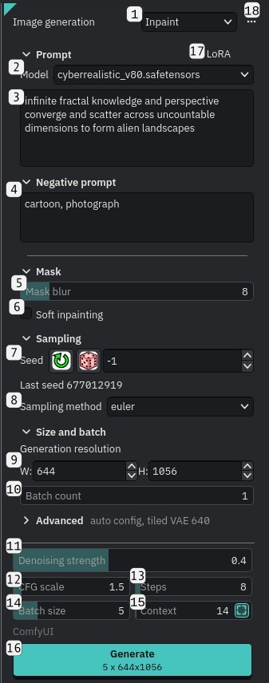
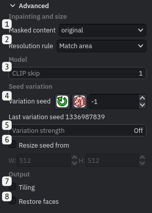
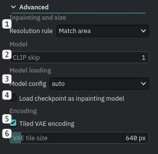
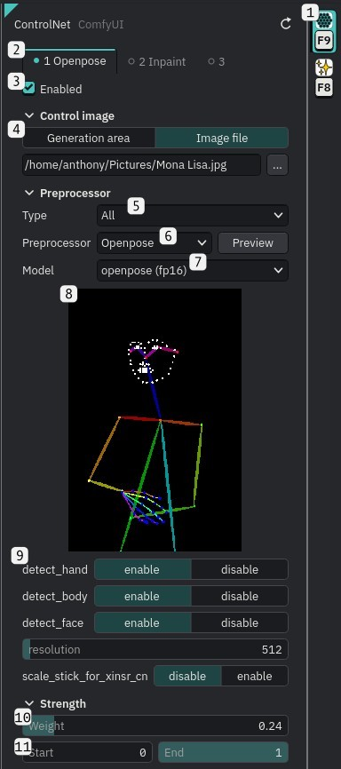
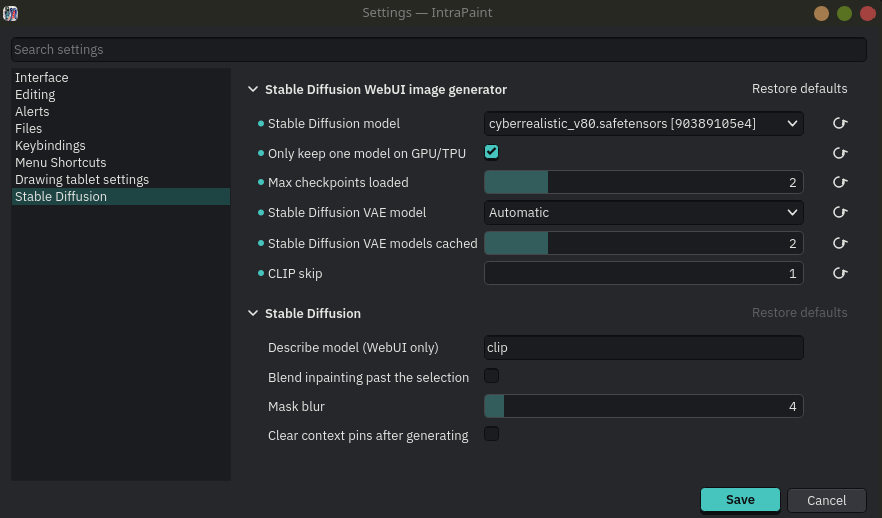

# Stable Diffusion Image Generation Controls

This guide covers the controls IntraPaint provides for AI image generation.  To access these controls, first install and configure Stable Diffusion following the [Stable Diffusion setup guide](./stable_diffusion_setup.md), and activate it in the [generator selection window](./menu_options.md#image-generator-selection-window).  

When setting up Stable Diffusion, you have the option to choose between using
[ComfyUI](https://github.com/comfyanonymous/ComfyUI?tab=readme-ov-file#comfyui), the
[Stable Diffusion WebUI](https://github.com/AUTOMATIC1111/stable-diffusion-webui?tab=readme-ov-file#stable-diffusion-web-ui),
[WebUI Forge](https://github.com/lllyasviel/stable-diffusion-webui-forge?tab=readme-ov-file#stable-diffusion-webui-forge),
or [WebUI reForge](https://github.com/Panchovix/stable-diffusion-webui-reForge?tab=readme-ov-file#stable-diffusion-webui-forgereforge)
to handle IntraPaint's AI image generation requests. In most cases these options will all work the same within IntraPaint,
but there are a few minor differences in the available controls.

---

## Table of Contents

1. [Image Generation Panel](#image-generation-panel)
2. [ControlNet Panel](#controlnet-panel)
3. [Stable Diffusion settings](#stable-diffusion-settings)
4. [Prompt control formatting](#prompt-control-formatting)
5. [Denoising strength comparisons](#denoising-strength-comparisons)
6. [Sampling methods](#sampling-methods)
7. [AI upscaling with IntraPaint](#ai-upscaling-with-intrapaint)

---

## Image Generation Panel

This panel is the main place where you'll control image generation. Press F8, or click its icon in the [panel rail](./controls.md#main-view), to show or hide it.

The panel's controls are grouped into sections. Click a section's title to collapse or expand it. A collapsed section shows a short summary of its settings beside its title, like the collapsed **Advanced** section in the screenshot below. When the panel is short on space, it collapses some sections on its own. The controls you use after every generation, from **Denoising strength** down to the **Generate** button, stay at the bottom of the panel and never scroll out of view.

Which controls are shown depends on the edit mode: the **Mask** section and the **Context** field only appear in Inpaint mode, and **Denoising strength** is hidden in Text to Image mode.

1. **Edit mode dropdown**: Switch between the three main image generation modes:
   - **Inpaint**: Only selected content in the generation area is changed.
   - **Image to Image**: The entire generation area is changed, but previous image content affects the new image.
   - **Text to Image**: Previous image content is ignored, a new image is generated using only prompt data and other settings.

   In any mode other than Inpaint, the dropdown is drawn in a warning color, and a note above the **Generate** button names the mode, so you don't accidentally replace the whole generation area.
2. **Model dropdown**: Selects which Stable Diffusion model file will be used for image generation.  If you're using the WebUI generator, changing this value will immediately load the new model, while ComfyUI will wait to load the model until the next time you start image generation.
3. **Prompt**: Describe in plain text exactly what kind of imagery the model should generate. Prompts can also use various control formats to affect image generation, see [prompt control formatting](#prompt-control-formatting) below for details.
4. **Negative prompt**: Describe in plain text exactly what kind of imagery the model should *not* generate. All prompt control formats also work on the negative prompt. Click its title to fold it down to a single line showing its text, or to expand it again.
5. **Mask blur**: How much to blur the edge of the inpainting selection, in pixels at the generation resolution, so generated content blends smoothly into the original image. The same value can also be changed in the [Stable Diffusion settings](#stable-diffusion-settings).
6. **"Soft inpainting" checkbox**: Treats the blurred edge of the selection as a gradual change, so inpainted content blends into its surroundings even at high denoising strength. A wider mask blur widens the gradual band, and a hint appears below the checkbox if the mask blur is too small for soft inpainting to have much effect. Once checked, a **Soft inpainting settings** fold below it holds extra options provided by the image generator. This checkbox is only shown if the connected generator supports soft inpainting.
7. **Seed**: A number used to control randomness during image generation.  If all other factors are unchanged, using the same seed value should produce the same images each time. If set to -1, a different random seed will be used each time you generate images. The **Last seed** line below it shows the seed used the last time images were generated.
   - The **"Reuse last seed" button** (green arrow) replaces the seed with the last seed.
   - The **"Randomize seed" button** (dice) sets the seed value to -1, so that a random value will be used for each image generation.
8. **Sampling method dropdown**: Selects between different mathematical approaches to dividing the image generation process into steps.  The differences between these can be subtle, see [sampling methods](#sampling-methods) below for more details.
9. **Generation resolution**: The resolution of generated images.  Most Stable Diffusion models can be somewhat flexible with this, but usually will perform best at specific resolutions. By default, this follows the size of the generation area. The **Resolution rule** in the [Advanced section](#advanced-section) controls that, and editing the resolution by hand switches the rule to "Manual". See also: [generation resolution tips](./inpainting_guide.md#generation-resolution)
10. **Batch count**: The number of image batches to generate in sequence before switching to the selection view. This doesn't increase VRAM usage like batch size does, but it provides no speed benefits compared to generating batches individually.
11. **Denoising strength**: In "Inpaint" and "Image to Image" modes, this controls exactly how much of the source image the AI generator will include in its output. See [denoising strength comparisons](#denoising-strength-comparisons) below for examples.
12. **CFG scale**: Controls how strongly the generator will follow the prompt. Low values produce more random imagery, while high values de-prioritize image composition to focus more on exactly matching the AI model's understanding of your prompt.  Values in the 6-12 range usually produce the best results, except with specialty models like LCM and Turbo, which need much lower values.
13. **Steps**: Controls how many steps the generator takes to create images. Increasing the steps makes image generation take longer, but often provides better results.  Benefits of increasing the steps are usually fairly low above 30 steps. Certain specialty models (e.g. LCM and Turbo) can produce good results at far fewer steps.
14. **Batch size**:  The number of images to generate at once.  Generating multiple images at the same time can be faster, but requires more VRAM.
15. **Context**: When inpainting, controls whether generation is limited to selected content within the generation area, and how much extra context is left around it. The button at the right end of the field turns the limit on or off:
    - **On**: Crops to selected content, increasing detail quality at the cost of situational awareness. The value sets how many pixels of context are kept around the selection, letting you finely balance the trade-offs between detail quality and situational awareness. [Context pins](./menu_options.md#clear-context-pins-ctrlaltp) stretch the context further.
    - **Off**: The field reads "whole area", and the entire generation area is used.

    Refer to the [inpainting guide](./inpainting_guide.md#limit-context-to-the-selection-checkbox) for more details about using this effectively. While the WebUI generator's **Tiling** option is on, inpainting always uses the whole area.
16. **Generate button**: Click to trigger AI image generation, creating or altering image content to insert into the [generation area](./inpainting_guide.md#generation-area). Clicking this will switch IntraPaint to the [generated image selection view](./controls.md#generated-image-selection-view). The second line on the button shows how many images will be generated, and at what resolution. The line above the button names the active image generator. When the WebUI generator's **Tiling** option is on, a **Tiling on** button also appears above it, which turns tiling off when clicked.
17. **LoRA button**: Opens the [LoRA model window](./menu_options.md#view-lora-models-ctrlalt2), for adding LoRA models to the prompt. It is only shown when at least one LoRA model is available. When using the WebUI generator, a **Styles** button beside it opens the [saved prompt style window](./menu_options.md#view-saved-prompt-styles-ctrlalt1), if any prompt styles are saved.
18. **More menu**: Holds less frequently used actions:
    - **Describe** (WebUI generator only): Use AI image analysis to automatically generate a description of the section of the image in the generation area.  The new description will replace the current prompt.
    - **Select image generator...**: Opens the [generator selection window](./menu_options.md#image-generator-selection-window).
    - **Stable Diffusion settings...**: Opens the [Stable Diffusion settings](#stable-diffusion-settings).
    - **LCM mode**: Adjusts generation settings for use with an LCM model, see [LCM mode](./menu_options.md#lcm-mode-f10). It is only shown when LCM support is detected.
    - **Clear GPU memory** (ComfyUI generator only): Sends a request to ComfyUI to free up memory and unload cached models.  This might be useful if you're seeing worse performance after switching between multiple models, but it will probably make the next set of generated images load slightly slower.

---

### Advanced section

The **Advanced** section at the bottom of the panel holds settings that rarely need to change. It starts out collapsed, and its summary lists any settings that differ from the usual ones. Its contents depend on which image generator is active.

#### Advanced section: WebUI generator

1. **Masked content dropdown**: Controls how selected areas are processed when inpainting, usually best left unchanged. It is only shown in Inpaint mode. Available options:
   - **original**: Make no changes to inpainting content before generating. This is the best option in most circumstances.
   - **fill**:  Fill the inpainting selection with a solid color before generating. This is sometimes useful when trying to completely remove elements, but is usually best done manually with the brush tool.
   - **latent noise**:  Fill the inpainting selection with random noise before generating.  When used with denoising strength set around 0.7-0.8, this can be useful for filling in empty space around an existing image.
   - **latent nothing**:  Completely zeroes out the inpainting content before generating.
2. **Resolution rule dropdown**: Controls how the [generation resolution](#image-generation-panel) follows changes to the generation area's size:
   - **Match area**: Sets the generation resolution to the generation area's size.
   - **Match area, upscale small areas**: Also scales small areas up by a whole-number factor, until their shorter side reaches the "Minimum generation resolution" set in the [settings window](./menu_options.md#preferences-ctrlk).
   - **Manual**: Leaves the generation resolution alone. The dropdown is drawn in a warning color while this is selected. Editing the generation resolution by hand selects this option.
3. **CLIP skip**: Sets how many final image generation steps are taken without the guidance of the CLIP image recognition module. Increasing this number can sometimes improve generated image aesthetics, but it will also reduce adherence to the prompt.  In most cases this is best left at 1, but some models recommend setting it to 2.
4. **Variation seed**:  A number used to control the randomized variations between images in the same batch when the "Variation strength" control is used. If set to -1, a random seed will be used each time. Its buttons work like the [Seed](#image-generation-panel) buttons, and the **Last variation seed** line below it shows the variation seed used the last time images were generated.
5. **Variation strength**:  Controls how much images in the same batch should differ from each other.  The higher the value, the more significant the differences will be.  At zero it reads "Off", and variations between images will be completely random.
6. **"Resize seed from" checkbox and size**: Even if prompt, seed, and all other settings are unchanged, altering the generation resolution can completely change the results of image generation.  When checked, this option counters that effect, so that you can completely regenerate an image at a different resolution and still expect the final image to be very similar. The width and height below it set what resolution it should target.  If you're trying to recreate a generated image at a new size, you'll want to set this to the original generation resolution.
7. **"Tiling" checkbox**: If checked, Stable Diffusion will attempt to generate images that can be seamlessly repeated in a grid. This is mostly useful for generating texture files and tiling wallpapers. While tiling is on, a **Tiling on** button appears above the Generate button, and inpainting ignores the context limit.
8. **"Restore faces" checkbox**: If checked, apply an extra face restoration model to generated images. This option is rarely useful, most recent Stable Diffusion models already produce better results than dedicated face restoration models.

---

#### Advanced section: ComfyUI generator

1. **Resolution rule dropdown**: Controls how the generation resolution follows changes to the generation area's size, as described in the [WebUI generator's Advanced section](#advanced-section-webui-generator).
2. **CLIP skip**: Sets how many final image generation steps are taken without the guidance of the CLIP image recognition module. In most cases this is best left at 1, but some models recommend setting it to 2.
3. **Model config dropdown**: Some Stable Diffusion models come with config files, used to control exactly how the model is loaded and applied.  This dropdown lets you select which of those config files (if any) get applied during image generation.  If set to "auto", any config file with the exact same name as the Stable Diffusion model will be used. If no such config file exists, the model is loaded without a config file.
4. **"Load checkpoint as inpainting model" checkbox**: Some Stable Diffusion models have extra layers for improving inpainting results.  To fully take advantage of this, the models need to be loaded in a specific way.  The WebUI generator can automatically detect when this is necessary, but the ComfyUI generator cannot.  Checking this option will make ComfyUI load the selected Stable Diffusion model as an inpainting model.
5. **"Tiled VAE encoding" checkbox**:  If checked, the encoding and decoding steps of the image generation process will divide up the task into multiple image tiles instead of attempting to process the entire image at once.  This has the potential to significantly decrease memory requirements for generating very large images, but may slightly impact the final results.
6. **VAE tile size**: If "Tiled VAE encoding" is checked, this option controls the width and height in pixels of each tile in the tiled encoding/decoding process.

## ControlNet Panel

[ControlNet](https://github.com/lllyasviel/ControlNet) is an add-on for Stable Diffusion that lets you restrict image generation in useful ways, usually by forcing it to not change parts of a source image.  The first three examples under [this section of the README](../README.md#why-combine-ai-and-traditional-tools) all use the ControlNet sketch module to preserve initial image composition.

If the ControlNet panel isn't available or isn't working properly, refer to [this section of the FAQ](../README.md#q-where-are-the-controlnet-options).

ControlNet works with two components: a **preprocessor**, and an AI **model**. The preprocessor identifies the elements that need to be preserved, and the model forces Stable Diffusion to preserve those elements.  Not all preprocessors and models are compatible, but it's usually obvious from their names which ones are meant to be used together.
The wide variety of ControlNet preprocessors and models available can be challenging to sort through, but I've found [this guide](https://education.civitai.com/civitai-guide-to-controlnet/#what-do-the-models-do) to be extremely helpful for sorting through them all.

1. **ControlNet panel icon**: Click this icon in the [panel rail](./controls.md#main-view), or press F9, to show or hide the ControlNet panel. When any ControlNet units are enabled, a number on the icon shows how many.
2. **ControlNet unit tabs**: Up to three different ControlNet units can be used at once. These tabs let you switch between the three and configure them independently. Each tab shows the unit's number and control type, and its dot fills in while the unit is enabled. The reset button at the top right of the panel resets the selected unit to its default settings.
3. **"Enabled" checkbox**: Enable or disable the current ControlNet unit. A disabled unit with settings other than the defaults shows a summary of them in place of its controls. Click **Edit settings** to change them without enabling the unit.

   Some preprocessors, such as the inpainting ones, need the inpainting selection to work. Outside Inpaint mode, units using them are skipped: their dot is drawn in a warning color, and a note under the checkbox explains why.
4. **Control image**: Most ControlNet modules need an initial image to function. Choose **Generation area** to use the contents of the generation area, or **Image file** to use a separate image file. When using an image file, enter its path in the field below, or click the **...** button to choose one.
5. **Type dropdown**:  An optional dropdown that lets you limit preprocessor and model dropdowns to a few useful presets.
6. **Preprocessor dropdown and "Preview" button**: Selects the pre-processing module used to prepare the control image for use. Click **Preview** to apply the preprocessor to the control image and display the results below. This is useful for confirming that a preprocessor is actually isolating the image elements that you want to preserve.
7. **Model dropdown**: Selects the control model used to guide image generation.
8. **Preprocessor preview image**: When you click the "Preview" button, this is where the preview will be shown. Selecting a different preprocessor will clear the preview.
9. **Preprocessor options**: Some preprocessors provide extra options that you can adjust to control how they work.  If you select one of those preprocessors, those controls will appear here. When using the WebUI generator, two more checkboxes appear below them:
    - **Pixel perfect**: Enables hidden automatic size adjustments to improve ControlNet results. In most cases, it's probably best to just keep this checked.
    - **Low VRAM**: Systems with limited VRAM might fail to generate images with ControlNet active. Selecting this option will fix some of these issues, but may also slow down image generation.
10. **Weight**: Controls how strictly the model will guide image generation. 1.0 is the default value, lower values decrease the effect of ControlNet.
11. **Start and End**: Set the steps in the image generation process where ControlNet is activated and deactivated, as fractions of the total step count.  The defaults are 0 and 1, which apply ControlNet from the first step to the last.

---

### Stable Diffusion settings

When a Stable Diffusion image generator is active, extra options will be available in the **Stable Diffusion** category of the [settings window](./menu_options.md#preferences-ctrlk). You can also open it from the Image Generation panel's [More menu](#image-generation-panel).

- **"Stable Diffusion WebUI image generator" section**:  This section will only be visible if you're using the Stable Diffusion WebUI image generator.  Instead of being saved with IntraPaint application files, these settings are read directly from the WebUI, and any changes made to them are sent back to the WebUI on save.
  - **Stable Diffusion model**: Select an installed Stable Diffusion model file to use for image generation.
  - **Only keep one model on GPU/TPU**: If checked, the Stable Diffusion WebUI will fully unload any previously selected model from the GPU before loading a new one.  Unchecking this allows for faster model swapping, but it is very likely to cause out-of-memory errors on most GPUs.
  - **Max checkpoints loaded**: Sets how many recent Stable Diffusion models are held in RAM at one time.  Keeping models in RAM allows for faster model swapping, but not quite as fast as keeping them on the GPU.
  - **Stable Diffusion VAE model**: Sets the secondary model that Stable Diffusion uses for encoding and decoding latent image data. These models are not as influential as the primary model files, but they can have significant impact on color balance and detail quality.
  - **Stable Diffusion VAE models cached**: Number of VAE models to keep loaded in RAM at one time.
  - **CLIP skip**: Sets how many final image generation steps are taken without the guidance of the CLIP image recognition module.  In most cases this is best left at 1, but some models recommend setting it to 2.
- **"Stable Diffusion" section**:  Settings in this section are handled directly by IntraPaint, and don't need to be sent back to the connected generator.
  - **Describe model (WebUI only)**: Enter the image recognition model that the Stable Diffusion WebUI will use when "Describe" is run.  Any option other than "clip" will probably need to be configured separately within the WebUI. As the ComfyUI generator does not support Describe, this option won't do anything under that generator.
  - **Blend inpainting past the selection**: If checked, the soft edge of inpainted content can extend past the edge of the selection, as far as the mask blur reaches. When unchecked, inpainting never changes pixels outside the selection.
  - **Mask blur**: The same mask blur value found in the Image Generation panel's [Mask section](#image-generation-panel).
  - **Clear context pins after generating**: If checked, all [context pins](./menu_options.md#clear-context-pins-ctrlaltp) are removed when a generated image is applied to the image.

---

## Prompt control formatting:

Prompt text can be formatted in various ways to control its behavior. These controls are provided by the [Stable Diffusion WebUI](https://github.com/AUTOMATIC1111/stable-diffusion-webui/wiki/Features) and can be altered by various webui extensions.

| Control             | Example                                             | Description                                                                                                                                                |
|---------------------|-----------------------------------------------------|------------------------------------------------------------------------------------------------------------------------------------------------------------|
| Boost attention     | `red and (blue)`                                    | `blue` is treated as 1.1x more important                                                                                                                   |
| Decrease attention  | `cat and [dog]`                                     | `dog` is treated as 1.1x less important                                                                                                                    |
| Precise attention   | `(field:2.0) of (flowers:0.5)`                      | `field` is prioritized 4x more than `flowers`                                                                                                              |
| Literal characters  | `special characters \(\)\[\]`                       | Bracket characters are taken literally, and don't affect attention                                                                                         |
| Prompt editing      | `blue sky, [painting:photograph:8]`                 | After eight steps, the prompt switches from `painting` to `photograph`                                                                                     |
| Alternating prompts | `a friendly [dog\|cat]`                             | Switch between `dog` and `cat` after each image generation step                                                                                            |
| Composable prompts  | `photograph of a house:0.5 AND charcoal sketch:1.0` | Sections split by AND are treated as individual prompts, to be applied simultaneously. The numbers at the end control how much that prompt is prioritized. |

## Denoising strength comparisons

The examples below were created by applying increasing denoising strengths to a small elliptical area within an AI-generated image using inpainting mode. All other parameters remain the same for each option.

| Strength       | Example                                                                    | Description                                                                                                                                                                                                                                                                                                                                                                  |
|----------------|----------------------------------------------------------------------------|------------------------------------------------------------------------------------------------------------------------------------------------------------------------------------------------------------------------------------------------------------------------------------------------------------------------------------------------------------------------------|
| 0.0 (unedited) |    | At zero denoising strength, inpainting and image to image do nothing at all.                                                                                                                                                                                                                                                                                                 |
| 0.1            |  | Only the tiniest changes are visible. Because the image is inpainted at a higher resolution than it was originally generated at, even this strength shows slight improvements in details.                                                                                                                                                                                    |
| 0.2            |  | Changes increase in strength, but are still minimal. Some details are improved, but others actually look slightly worse, as the generator has enough leeway to emphasize them but not enough to fix them. This is the lowest strength I regularly use, mostly when editing areas where I want only very slight corrections                                                   |
| 0.3            |  | The original image was generated with the base Stable Diffusion 1.5 model, but the inpainting is using the fine-tuned [CyberRealistic model](https://huggingface.co/cyberdelia/CyberRealistic/tree/main).  The difference in realism between the two models starts to become apparent at this step.                                                                          |
| 0.4            |  | The most significant errors have been corrected, but overall composition is still mostly the same. This is the strength I usually for refining sketches and rough details.                                                                                                                                                                                                   |
| 0.5            |  | Original image content and new image content are roughly equal in weight. The broad details are still the same, but individual elements start to move from their former places.                                                                                                                                                                                              |
| 0.6            |  | New content starts to outweigh old content. This strength is good for fixing significant errors like malformed limbs.                                                                                                                                                                                                                                                        |
| 0.7            |  | Content sharply diverges from the original. The need to follow the prompt (some variant of "bonsai, cabinet of curiosities in the ancient archives") now outweighs the need to make changes fit in with the old image content.                                                                                                                                               |
| 0.8            |  | Original image content is no longer relevant enough to keep the edges coherent, and we start to see a distinct border around the inpainting area.  This strength is still useful sometimes, but usually requires extra work to blend in the content. This usually involves the [smudge tool](./tool_guide.md#-smudge-tool-shifts), lower strength inpainting operations, or both. |
| 0.9            |  | A tiny increase in detail over the last step, but errors at the edges of the inpainting selection become even more pronounced.                                                                                                                                                                                                                                               |
| 1.0            |  | Details become strikingly different, original image content is completely lost. The shape of the inpainting selection and the area outside the selection still have some influence on the image, but not much.                                                                                                                                                               |

## Sampling methods

The sampling method controls how the image diffusion process is divided into smaller steps to produce the final image. Each of these will tend towards slightly different results, but the differences are usually minor. Here's a brief glossary:

- Euler: The simplest sampling process, usually a good default.
- UniPC (Unified Predictor-Corrector): A more efficient sampling method that can produce decent images in 5-10 steps.
- Ancestral (A) samplers: Any sampler ending in "A" adds extra randomness to the process.
- Karras samplers: Use gradually decreasing amounts of randomness, potentially improving image quality.
- LCM: Very fast image generation (5-10 steps), but requires either an LCM LoRA or an LCM model.
- DPM (Diffusion probabilistic model solver): Solver variants released in 2022.
- Heun: A slower but more precise variant of Euler.
- LMS (Linear Multi-Step), PLMS (Pseudo Linear Multi-Step), and DDIM (Denoising Diffusion Implicit Model): Older methods, not commonly used.
- Turbo: Extremely fast image generation (1 step), but requires an SDXL Turbo model.

### AI upscaling with IntraPaint:

For an overview of the basic image scaling interface, see the [menu option guide's image scaling section](./menu_options.md#scale-image-window).

#### Prerequisites for effective upscaling:

1. For the absolute best results, you'll need ControlNet support and a ControlNet tile model.  See [this section](../README.md#q-where-are-the-controlnet-options) if the ControlNet panel and upscaling options aren't showing up.
2. The default installation of ControlNet only includes a version of the tile model that supports Stable Diffusion 1.5, so make sure you're not using an SDXL model.  If you do want to use SDXL, you'll need to find and install an SDXL tile model, then select it in the scale image window's **Tile ControlNet model** dropdown.
3. If you've installed the [ultimate-upscale-for-automatic1111 extension](https://github.com/Coyote-A/ultimate-upscale-for-automatic1111), or [ComfyUI UltimateSDUpscale custom nodes](https://github.com/ssitu/ComfyUI_UltimateSDUpscale?tab=readme-ov-file), IntraPaint will use them to improve tiled upscaling.
   - If you're using the Stable Diffusion WebUI image generator, you can open <http://localhost:7680> in a web browser, and from there follow [these instructions](https://github.com/Coyote-A/ultimate-upscale-for-automatic1111/wiki/How-to) to install the extension.
   - If you're using the Stable Diffusion ComfyUI image generator, you can use [ComfyUI Manager](https://github.com/ltdrdata/ComfyUI-Manager?tab=readme-ov-file#comfyui-manager) to install the custom nodes, or use git to [clone the ComfyUI_UltimateSDUpscale repository in the ComfyUI/custom_nodes/ directory](https://github.com/ssitu/ComfyUI_UltimateSDUpscale?tab=readme-ov-file#installation).

#### Steps for getting the best results:

1. When using AI upscaling, some of the settings in the image generation panel affect the results. Make sure to select appropriate values:
   - **Prompt**: Should accurately describe your entire image, ideally without being too focused on specific details.
   - **Generation resolution**: Sets the size of each upscaling tile. Set this to the resolution your model works best at, *not* the resolution of the final image.
2. In the scale image window, choose the **AI upscaling** mode, and keep its **Denoising strength** relatively low, certainly no higher than 0.5. If you didn't install the ultimate upscale extension, you may need to reduce it even more.
3. Select an **Assisting upscale method** that works well with the type of image you're adjusting, as this gets used as an initial step alongside Stable Diffusion upscaling.  I've found SwinIR_4x to be a good choice in most cases.
4. Make sure a **Tile ControlNet model** is selected. If those options aren't visible, the upscale won't use ControlNet.
